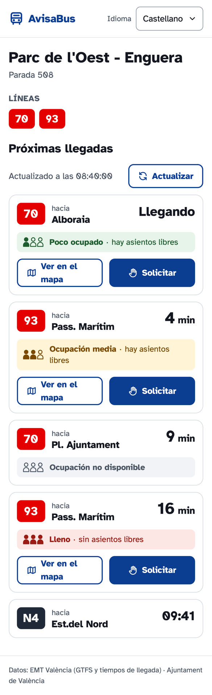
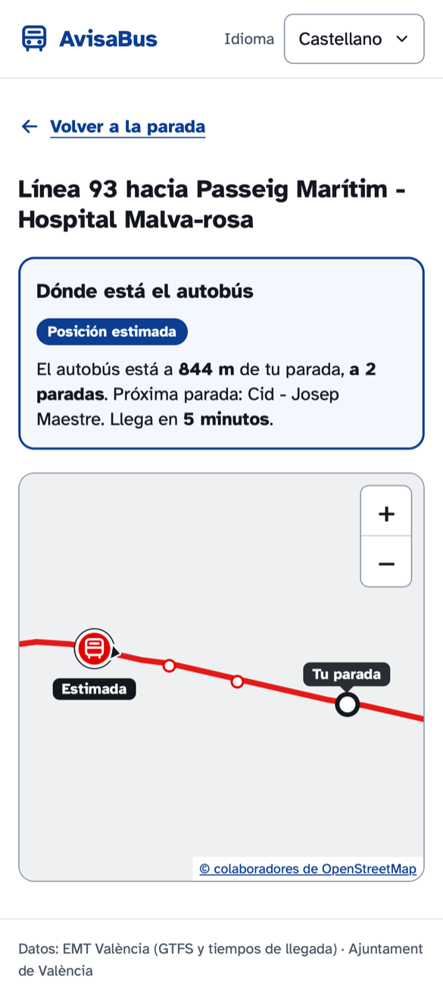
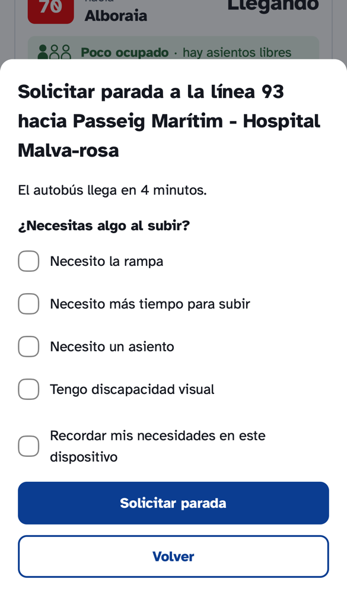
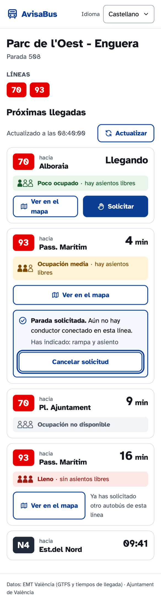
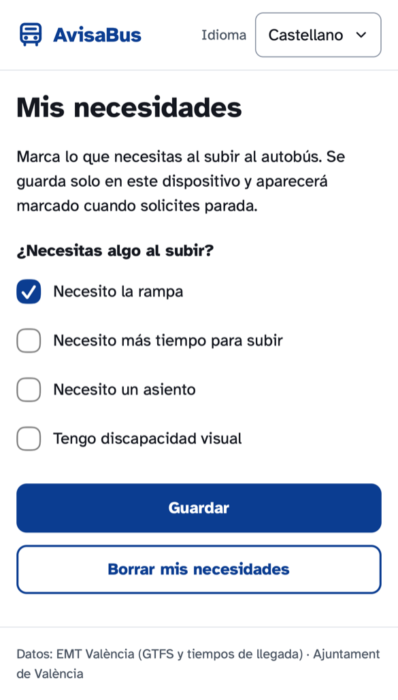
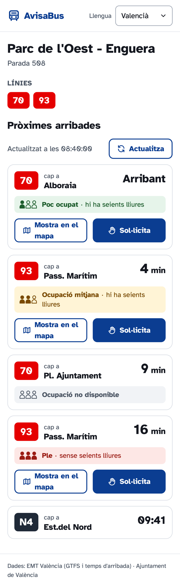
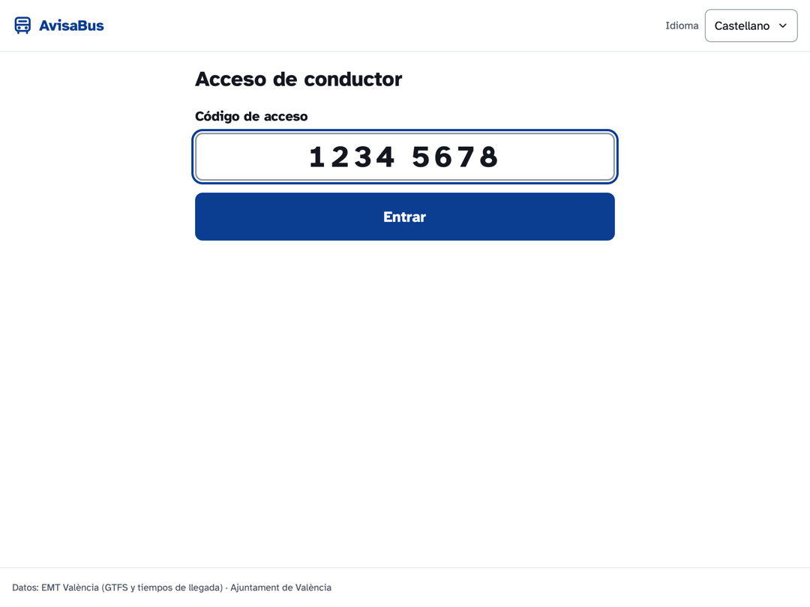
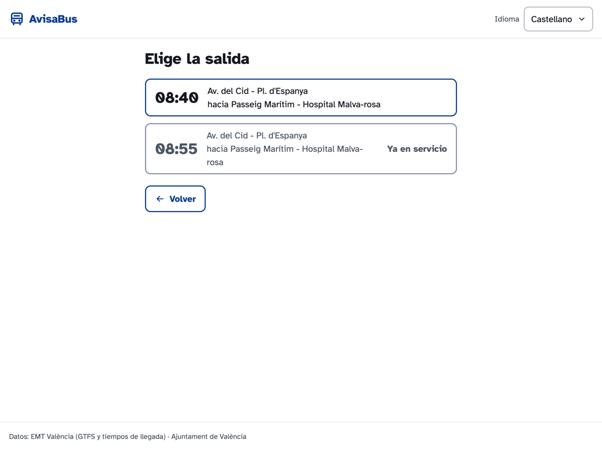
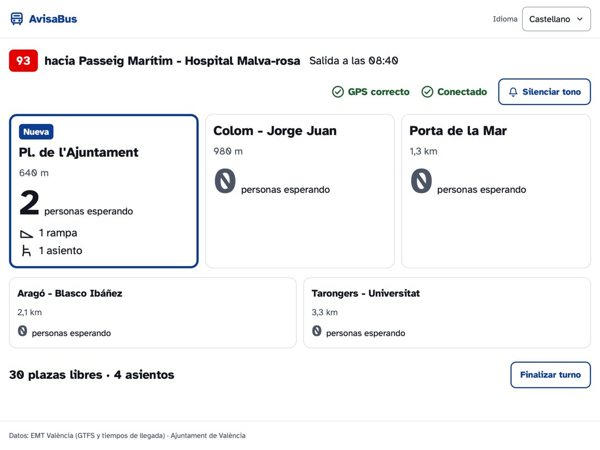
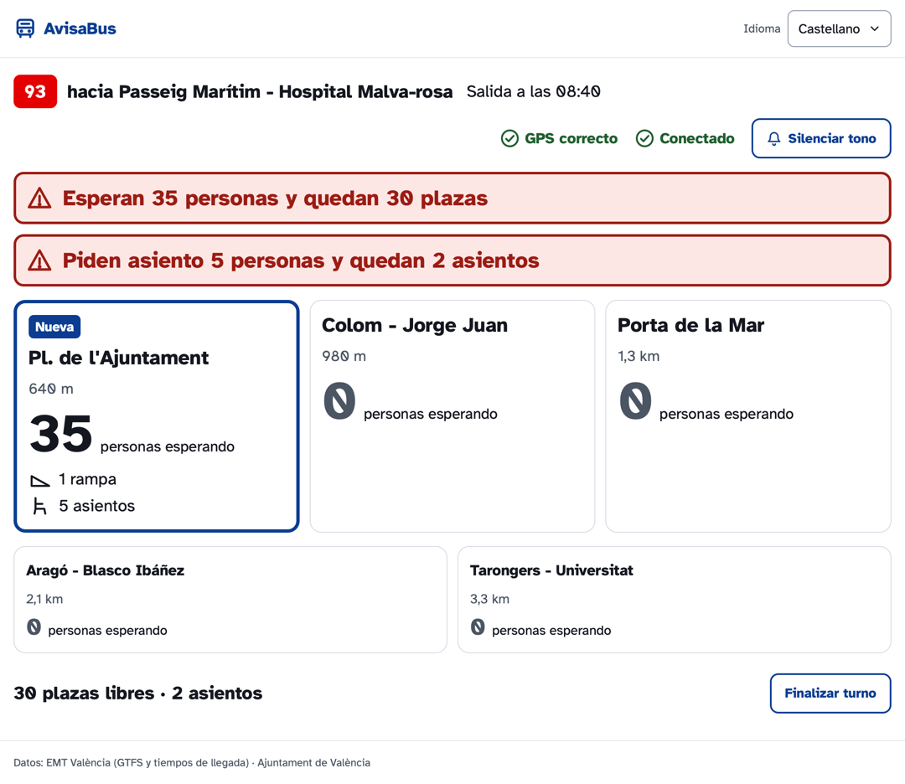

# AvisaBus

Aplicación web progresiva (PWA) accesible que conecta a los **pasajeros** y a los **conductores**
de EMT València:

- El **pasajero** escanea el código QR de su parada y ve, sin registrarse ni instalar nada,
  cuánto falta para cada línea, por dónde va el autobús y cómo de lleno viene. Si lo necesita,
  **avisa al conductor** de que le espera e indica si necesita rampa, más tiempo para subir o un
  asiento.
- El **conductor** ve en una tablet cuántas personas le esperan en sus próximas paradas y quién
  necesita ayuda para subir. Recibe una alerta si no va a caber todo el mundo.

Es un proyecto académico (Trabajo Fin de Máster) desarrollado con **Spec Driven Development
(spec first)** y agentes de IA (Claude Code). Ninguna línea de código de producción se ha escrito
sin una especificación aprobada antes por una persona.


## Contenido

- [Funcionalidades](#funcionalidades)
- [Uso en producción](#uso-en-producción)
- [Capturas](#capturas)
- [Arquitectura](#arquitectura)
- [Stack tecnológico](#stack-tecnológico)
- [Requisitos previos](#requisitos-previos)
- [Instalación](#instalación)
- [Ejecución en local](#ejecución-en-local)
- [Verificación y tests](#verificación-y-tests)
- [Despliegue](#despliegue)
- [Estructura del repositorio](#estructura-del-repositorio)
- [Metodología: Spec Driven Development con agentes](#metodología-spec-driven-development-con-agentes)
- [Limitaciones conocidas](#limitaciones-conocidas)
- [Fuentes de datos y atribución](#fuentes-de-datos-y-atribución)

## Funcionalidades

### Pasajero (móvil, a través del QR de la parada)

* Consulta los requisitos funcionales y no funcionales en ./docs/requirements

| Funcionalidad | Requisitos |
|---|---|
| Vista de parada por QR firmado (HMAC): nombre de la parada y líneas que pasan | RF-05, RF-06 |
| Próximas llegadas en tiempo real (SAE de EMT, caché de 20 s), con refresco automático | RF-07, RF-08, RF-10, RF-11 |
| Respaldo con el horario programado del GTFS cuando no hay tiempo real, indicado en pantalla | RF-09 |
| Mapa con el trazado de la línea y la posición estimada del autobús | RF-12, RF-13 |
| Nivel de ocupación de cada autobús (libre, medio, lleno) y asientos libres | RF-14, RF-15 |
| Aviso al conductor ("espero la línea X") para el autobús elegido, con necesidades opcionales | RF-16, RF-17, RF-20 |
| Perfil de accesibilidad guardado solo en el dispositivo | RF-18 |
| Un aviso activo por dispositivo, parada y línea; cancelación; confirmación de entrega | RF-19, RF-22, RF-23 |
| Caducidad automática: cuando el autobús pasa, al llegar a la parada siguiente o por tiempo | RF-21 |

### Conductor (tablet)

| Funcionalidad | Requisitos |
|---|---|
| Acceso con código de conductor (sin cuentas ni contraseñas) | RF-24 |
| Elección de línea, sentido y salida (expedición) | RF-25 |
| Próximas paradas calculadas a partir del GPS de la tablet | RF-26 |
| Personas esperando en las 3 próximas paradas y sus necesidades, en tiempo real (WebSocket) | RF-27, RF-28 |
| Alerta de capacidad cuando no van a caber todos | RF-29 |
| Fin de turno, que borra la sesión y la posición | RF-30 |

### Administración (CLI `avisabus`)

| Comando | Para qué sirve |
|---|---|
| `avisabus gtfs import <zip o carpeta>` / `gtfs info` | Importar o renovar el feed GTFS de EMT y consultar su vigencia |
| `avisabus qr generate --stop <id> \| --all` | Generar los QR de las paradas (SVG o PNG) y su `index.csv` con las URL |
| `avisabus driver-codes create --label <texto>` / `list` / `revoke` | Gestionar los códigos de acceso de los conductores |
| `avisabus simulate --line <L> --direction <D>` | Simular el recorrido GPS de un conductor por el trazado real de una línea |
| `avisabus sae fetch` / `sae record` | Consultar el SAE y grabar sesiones reales para reproducirlas |
| `avisabus occupancy override` | Forzar el nivel de ocupación de una línea (demostraciones) |
| `avisabus openapi export` | Exportar el contrato OpenAPI con el que se generan los tipos del frontend |

Guía completa de cada comando, con opciones y ejemplos: [`docs/cli.md`](docs/cli.md).

### Transversales

- **Accesibilidad (WCAG 2.1 AA):** comprobada con axe en los tests end-to-end. Zonas táctiles de
  44 px o más, lectores de pantalla y tipografía Atkinson Hyperlegible.
- **Idiomas:** castellano y valenciano, con selector en la interfaz. Los nombres de paradas y
  líneas se muestran tal como vienen en el GTFS.
- **PWA:** instalable y con *service worker*. Pensada para Safari iOS y Chrome Android, y los
  tests end-to-end se ejecutan con perfiles de iPhone, Pixel y iPad.
- **Privacidad por diseño:** sin cuentas ni datos personales. El dispositivo se identifica con un
  hash, las necesidades de accesibilidad se borran cuando caduca el aviso y ningún log guarda IP
  ni identificadores.
- **Seguridad:** HTTPS, tokens de parada firmados, límite de peticiones por dispositivo e IP y
  bloqueo tras varios códigos de conductor erróneos.

## Uso en producción

AvisaBus está publicada en **<https://avisabus.yeddarpi.com>**, sobre la red real de EMT València
(GTFS) y desplegada en una Raspberry Pi.

Hay dos papeles, y cada uno se usa en su propio dispositivo o ventana del navegador:

| Papel | Dónde | Cómo se entra |
|---|---|---|
| **Pasajero** | Móvil (o cualquier navegador) | Escaneando el QR de una parada, o abriendo su enlace |
| **Conductor** | Tablet u ordenador con ubicación | `https://avisabus.yeddarpi.com/driver` con un código de conductor |

Los QR de todas las paradas ya están generados en el servidor. Para probar la vista del
conductor hay un código de demostración, **BigSchool**:

| Código de acceso | Uso |
|---|---|
| **`5177 6655`** | Escríbelo en `/driver`, con o sin el espacio |

Es un código de demostración: se revocará cuando termine la evaluación.

> **Tiempo real.** EMT retiró en noviembre de 2026 la página de la que AvisaBus leía las llegadas
> en tiempo real (ver [Limitaciones conocidas](#limitaciones-conocidas)). Por eso las paradas
> muestran el aviso **"Sin datos en tiempo real"** y las horas del horario programado. Todo lo
> demás funciona igual con esas horas: el mapa, la ocupación, las solicitudes de parada y la
> vista del conductor.

### Pasajero

1. **Abre una parada.** Escanea su QR o abre su enlace. Por ejemplo, la parada 496 *Cid - Casa
   de la Misericòrdia*, la tercera de la línea 93 hacia Passeig Marítim:
   <https://avisabus.yeddarpi.com/p/496?t=Ax0NYP3h21fhTXhh-qMiJw>.
   Sin un enlace firmado (`?t=…`), la parada no se abre: así nadie puede recorrer las paradas a
   ciegas.
   Hay más paradas de ejemplo, con sus QR para escanear desde la pantalla, en
   [`docs/qr/`](docs/qr/README.md).
2. **Consulta las llegadas.** Cada fila indica la línea, el destino, cuánto falta y lo lleno que
   viene el autobús. La vista se actualiza sola.
3. **Mira dónde está el autobús** con *Ver en el mapa*. Muestra el trazado de la línea, tu parada
   y la posición estimada del autobús, con un resumen en texto para lectores de pantalla.
4. **Solicita parada.** Pulsa *Solicitar* en el autobús que quieres coger, marca si necesitas
   algo al subir (rampa, más tiempo, asiento, discapacidad visual) y confirma con *Solicitar
   parada*.
   - Si no hay conductor en ese autobús, verás "Parada solicitada. Aún no hay conductor conectado
     en esta línea".
   - Cuando el conductor la recibe, el mensaje cambia a "El conductor ha recibido tu solicitud".
5. **Cancela** cuando quieras con *Cancelar solicitud*. Si no, la solicitud caduca sola cuando el
   autobús pasa o, como mucho, a los 30 minutos.

En cualquier pantalla puedes cambiar entre castellano y valenciano. En *Mis necesidades*, enlazado
desde la portada, guardas tu perfil, solo en tu dispositivo, para que aparezca marcado en cada
solicitud.

### Conductor

1. **Entra** en <https://avisabus.yeddarpi.com/driver> con el código de conductor.
2. **Elige la línea, el sentido y la salida** (la hora a la que sale de cabecera). Las salidas
   que ya lleva otro conductor aparecen como "Ya en servicio".
3. **Permite la ubicación.** La tablet envía su GPS y el sistema calcula las próximas paradas. En
   la cabecera se ve el estado: "GPS correcto" o "GPS desactualizado", "Conectado" o "Sin
   conexión".
4. **Atiende la demanda.** Se ven las 3 próximas paradas con cuántas personas esperan y qué
   necesitan, actualizadas al momento. Si no van a caber todas, aparece una alerta de capacidad.
5. **Finaliza el turno** con *Finalizar turno*. Se borran la sesión y la posición. Al llegar a la
   última parada, la vista muestra "Fin del recorrido".

### Recorrido de prueba sin salir a la calle

Para ver una solicitud llegar al conductor no hace falta estar en la parada. Basta con un
ordenador con Chrome para el conductor y un móvil (u otra ventana) para el pasajero.

1. **Conductor, en Chrome del ordenador:**
   - Abre las herramientas de desarrollo (`F12`), menú `⋮` → *More tools* → *Sensors* y, en
     *Location*, elige *Other…*. Escribe la posición de la primera parada de la línea 93,
     *Avinguda del Cid*: latitud `39.469711`, longitud `-0.416108`. Usa punto decimal y no olvides
     el signo menos de la longitud.
   - Entra en `/driver`, elige la **línea 93**, el sentido **Passeig Marítim - Hospital
     Malva-rosa** y la **primera salida cuya hora aún no ha pasado**. La lista incluye también
     las salidas de la última media hora. Deja abiertas las herramientas de desarrollo: al
     cerrarlas, Chrome deja de simular la ubicación.
   - Debe salir "GPS correcto". Las próximas paradas serán las siguientes a *Avinguda del Cid*.
2. **Pasajero, en el móvil:**
   - Abre el enlace de la parada 496 del paso 1 de [Pasajero](#pasajero).
   - En las llegadas de la línea 93 hacia Passeig Marítim, solicita parada en el autobús cuya hora
     corresponde a la salida que eligió el conductor: unos 4 minutos después de la hora de salida.
     Marca, por ejemplo, *Necesito la rampa*.
3. **Comprueba:**
   - **Conductor:** en pocos segundos, la parada *Cid - Casa de la Misericòrdia* muestra 1 persona
     esperando, con rampa.
   - **Pasajero:** el mensaje cambia a "El conductor ha recibido tu solicitud".
   - Si el pasajero cancela, la solicitud desaparece de la vista del conductor.

## Capturas

Capturas de la interfaz tomadas por los tests end-to-end (Playwright), con datos de prueba
que incluyen tiempo real. Las del pasajero son de un iPhone 14 y las del conductor, de una tablet
en horizontal. Las de los dos idiomas y los demás estados (sin conexión, errores, parada no
encontrada…) se generan en `frontend/test-results/` con `./init.sh verify --e2e`.

### Pasajero

| Llegadas de la parada | Mapa del recorrido | Solicitar parada |
|---|---|---|
|  |  |  |
| **Parada solicitada** | **Mis necesidades** | **En valenciano** |
|  |  |  |

Sin tiempo real, la parada muestra el horario programado con un aviso:
[captura](docs/screenshots/pasajero/06-sin-tiempo-real.png).

### Conductor

| Acceso con código | Elección de la salida |
|---|---|
|  |  |
| **Solicitud nueva en las próximas paradas** | **Alerta de capacidad** |
|  |  |

Al llegar a la última parada: [Fin del recorrido](docs/screenshots/conductor/05-fin-recorrido.png).

## Arquitectura

Monolito modular con **arquitectura hexagonal (puertos y adaptadores)**: el dominio no conoce
HTTP, SQL ni el SAE, y toda fuente externa (SAE, ocupación, GPS, reloj) entra por un puerto. Un
único proceso sirve la API REST, los WebSockets y las tareas de fondo, con SQLite y eventos en
memoria (ADR-003). La CLI comparte el mismo paquete.


El detalle (capas, API, eventos, modelo de datos, ADR y riesgos) está en
[`docs/architecture.md`](docs/architecture.md).

## Stack tecnológico

| Capa | Tecnologías |
|---|---|
| **Backend** | Python 3.12, FastAPI, Uvicorn, Pydantic v2 y pydantic-settings, SQLAlchemy 2 sobre SQLite (WAL), httpx, structlog (logs JSON), Typer (CLI), segno y Pillow (QR) |
| **Frontend** | React 19, TypeScript, Vite, React Router, TanStack Query, i18next, Leaflet y React Leaflet, Tailwind CSS 4, vite-plugin-pwa |
| **Calidad backend** | uv, pytest (con pytest-asyncio, Hypothesis y pytest-socket para impedir la red), Ruff, mypy, import-linter (reglas de la arquitectura hexagonal) |
| **Calidad frontend** | Vitest y Testing Library, Playwright con axe-core (end-to-end y accesibilidad), ESLint (con jsx-a11y e i18next), Prettier, tipos generados desde OpenAPI |
| **Despliegue** | Docker Compose, imágenes `linux/arm64`, nginx (contenedor `web`), Nginx Proxy Manager (TLS) en una Raspberry Pi |
| **Desarrollo** | Claude Code con subagentes (explorer, spec-writer, implementer, reviewer), GitHub (ramas y pull requests) |

## Requisitos previos

- **Python 3.12** y **[uv](https://docs.astral.sh/uv/)**
- **Node.js 22 o superior** y npm
- **Docker** con Compose y buildx, solo para construir las imágenes de producción. En macOS
  sirve, por ejemplo, Colima.
- El **feed GTFS de EMT València** (zip), publicado en los datos abiertos del Ajuntament de
  València. No se versiona en el repositorio.

## Instalación

```bash
git clone https://github.com/yeddar/avisabus.git
cd avisabus
./init.sh setup                         # uv sync, npm ci, crea data/ y .env desde .env.example
(cd frontend && npx playwright install chromium webkit)   # solo para los tests end-to-end
```

Coloca el feed GTFS descomprimido en `data/gtfs/emt/` e impórtalo en la base de datos local
(`data/avisabus.sqlite`):

```bash
cd backend
uv run avisabus gtfs import ../data/gtfs/emt
uv run avisabus gtfs info               # comprueba la vigencia del feed
cd ..
```

La configuración se hace con variables `AVISABUS_*` en el fichero `.env` de la raíz. Todas
tienen un valor por defecto seguro para desarrollo y están documentadas en
[`.env.example`](.env.example).

## Ejecución en local

```bash
./init.sh dev       # backend en http://localhost:8000 y frontend en http://localhost:5173
```

El servidor de desarrollo de Vite reenvía `/api` y `/ws` al backend.

**Como pasajero**, abre la URL firmada de una parada. Para obtenerla, genera su QR (la URL queda
en `index.csv`) y ábrela en el navegador o escanéala con el móvil:

```bash
cd backend
uv run avisabus qr generate --stop 508 --out ../data/qr-dev
cat ../data/qr-dev/index.csv            # http://localhost:5173/p/508?t=<token>
```

**Como conductor**, crea un código y entra en `http://localhost:5173/driver`:

```bash
uv run avisabus driver-codes create --label "Tablet de pruebas"
```

En un ordenador sin GPS, la posición se puede fijar con las herramientas de desarrollo del
navegador (Chrome: *Sensors → Location*). El simulador recorre una línea completa sin
interfaz con un código de conductor; es útil para ver los avisos llegar sin moverse:

```bash
AVISABUS_SIM_CODE=<código> uv run avisabus simulate --line 93 --direction 0
```

### Tiempo real: SAE y modo replay

La fuente de tiempos de llegada se elige con `AVISABUS_ARRIVALS_SOURCE`:

| Valor | Comportamiento |
|---|---|
| `http` (por defecto en dev y prod) | Consulta el SAE de EMT. Desde el 12/11/2026 la página ya no existe, así que se cae siempre al horario del GTFS. |
| `replay` (por defecto en tests) | Reproduce una sesión real grabada en hora punta (`stop_508_peak`, parada 508). Es la opción para demostraciones. |

```bash
# en .env
AVISABUS_ARRIVALS_SOURCE=replay
```

## Verificación y tests

```bash
./init.sh verify          # formato, lint, tipos, arquitectura y tests de backend y frontend
./init.sh verify --e2e    # además, tests end-to-end con Playwright y axe
./init.sh verify-deploy   # construye las imágenes de producción y las inspecciona (requiere Docker)
./init.sh status          # estado de cada feature según feature_list.json
```

- **Sin red ni reloj real:** pytest bloquea los sockets, el SAE se simula con grabaciones reales
  y el tiempo con un reloj falso. Así los tests son deterministas.
- **Trazabilidad:** cada criterio de aceptación de las specs (`<feature>.AC-n`) tiene al menos un
  test que lo cita, y `scripts/check_traceability.py` lo comprueba.
- **Cobertura:** mínimo del 80 % en `domain` y `application`.
- **Revisión:** ninguna feature se da por terminada sin `./init.sh verify` en verde y la revisión
  de un agente independiente ([`docs/verification.md`](docs/verification.md)).

## Despliegue

Producción en una **Raspberry Pi (arm64)** con Docker Compose, detrás de un Nginx Proxy Manager
que termina TLS:

- Las imágenes se construyen en el Mac y se envían por SSH con `deploy/ship.sh`, que admite
  `--rollback`.
- El GTFS se renueva con `deploy/gtfs-update.sh`.
- `deploy/smoke.sh <url>` comprueba el despliegue: rutas, cabeceras de seguridad, caché y
  WebSocket.

La guía completa (primer despliegue, actualizaciones, copias de seguridad y logs) está en
[`deploy/README.md`](deploy/README.md).

## Estructura del repositorio

```
.
├── README.md · AGENTS.md · CLAUDE.md · CHECKPOINTS.md
├── docs/                     # Fuente de verdad: visión → requisitos → casos de uso → arquitectura
├── specs/<feature>/          # Una spec por feature: requirements.md · design.md · tasks.md
├── progress/                 # Memoria de trabajo de los agentes: exploraciones, implementación, revisiones
├── feature_list.json         # Estado de cada feature (ciclo de vida spec → done)
├── init.sh                   # setup · dev · verify · verify-deploy · status
├── .claude/agents/           # Definición de los subagentes de Claude Code
├── backend/
│   ├── src/avisabus/
│   │   ├── domain/           # Modelos, servicios y puertos (sin dependencias externas)
│   │   ├── application/      # Casos de uso
│   │   ├── adapters/
│   │   │   ├── inbound/      # http (FastAPI), ws (WebSockets), cli (Typer)
│   │   │   └── outbound/     # gtfs, sae, persistence, occupancy, qr, security, events…
│   │   ├── background/       # Tareas periódicas (avisos, turnos, caducidad del GTFS, estadísticas del SAE)
│   │   └── main.py           # Composición de la aplicación
│   └── tests/                # unit · integration · fixtures (GTFS reducido, grabaciones del SAE)
├── frontend/
│   ├── src/
│   │   ├── features/passenger/   # Vista de parada, mapa, avisos, perfil de necesidades
│   │   ├── features/driver/      # Acceso, elección de salida, turno y demanda
│   │   ├── shared/               # API tipada, componentes de interfaz, utilidades
│   │   └── locales/              # es · ca-valencia
│   └── e2e/                  # Playwright + axe
├── deploy/                   # compose.yaml, nginx, ship.sh, gtfs-update.sh, smoke.sh, guía
├── scripts/                  # Comprobación de trazabilidad AC → tests
└── data/                     # (no versionado) GTFS, base de datos local
```

## Metodología: Spec Driven Development con agentes

Cada funcionalidad (*feature*) sigue el mismo ciclo, con puntos de control humanos
([`CHECKPOINTS.md`](CHECKPOINTS.md)):

```
pending → spec_draft →(aprobación humana)→ spec_approved → exploring → implementing → in_review → done
```

1. **spec-writer** redacta la spec de la feature a partir de `docs/`: requisitos con criterios de
   aceptación en formato EARS, diseño y tareas. **Una persona la revisa y la aprueba.**
2. **explorer** investiga lo necesario antes de implementar: datos reales del GTFS y del SAE,
   código existente, librerías.
3. **implementer** implementa con TDD exactamente lo que dicen las tareas. Si la spec no cubre
   un caso, se detiene y lo anota.
4. **reviewer**, un agente nuevo sin el contexto del implementer, comprueba cada criterio de
   aceptación con evidencias y emite un veredicto.
5. Cada feature se integra mediante una pull request que fusiona una persona.

| Documento | Contenido |
|---|---|
| [`docs/vision.md`](docs/vision.md) | Contexto, problema, actores, objetivos |
| [`docs/requirements.md`](docs/requirements.md) | Requisitos funcionales (RF-01…RF-35) y no funcionales (RNF-01…RNF-15) |
| [`docs/use_cases.md`](docs/use_cases.md) | Casos de uso y limitaciones conocidas |
| [`docs/architecture.md`](docs/architecture.md) | Arquitectura, API, despliegue, ADR, riesgos |
| [`docs/conventions.md`](docs/conventions.md) | Convenciones de código, glosario, tests, git |
| [`docs/design.md`](docs/design.md) | Guía visual: tipografía, color, componentes y textos |
| [`docs/specs.md`](docs/specs.md) | Formato de las specs e índice de features |
| [`docs/verification.md`](docs/verification.md) | Definición de terminado y proceso de revisión |
| [`docs/cli.md`](docs/cli.md) | Guía de la CLI de administración `avisabus` |
| [`AGENTS.md`](AGENTS.md) | Roles de los agentes, ciclo de vida y protocolo de sesión |

## Limitaciones conocidas

- **Tiempo real:** EMT retiró la página pública de llegadas el 12/11/2026 y no ofrece una API
  abierta ni GTFS-RT. La aplicación funciona con el horario programado hasta que haya una fuente
  autorizada ([`progress/explore_sae_v2.md`](progress/explore_sae_v2.md)).
- **Ocupación simulada:** EMT no publica datos de ocupación, así que se genera de forma
  determinista detrás de un puerto que podría conectarse a sensores reales (RF-14).
- **Posición estimada:** la posición del autobús en el mapa del pasajero se estima a partir del
  tiempo de llegada y del trazado. No es GPS real.
- **Vigencia del GTFS:** el feed de EMT caduca periódicamente y hay que renovarlo a mano.
  `/api/v1/health` indica los días que quedan y los logs avisan con 7 días de antelación.
- **Escala:** un único proceso con SQLite y eventos en memoria, dimensionado para una demostración
  de unos 200 clientes simultáneos.

## Fuentes de datos y atribución

- Datos de la red (GTFS): **EMT València**, publicados en los datos abiertos del **Ajuntament de
  València**.
- Tiempos de llegada: sistema SAE de **EMT València**.
- Mapas: © colaboradores de **OpenStreetMap**.
