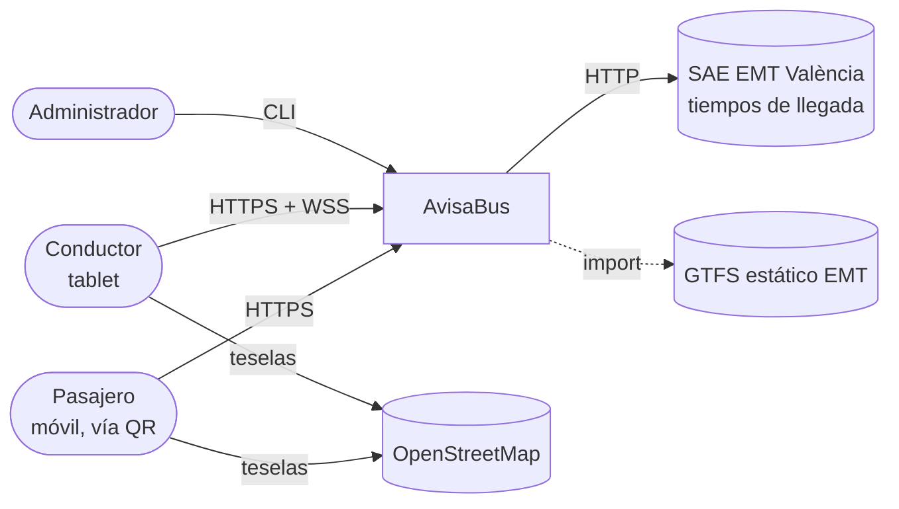
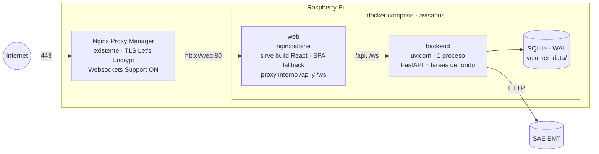
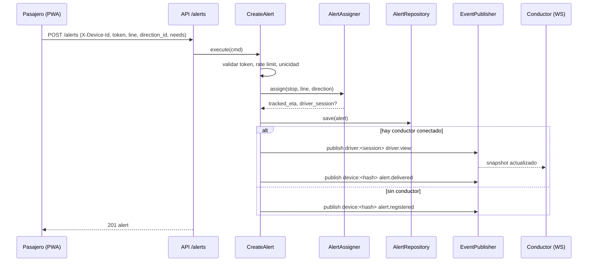
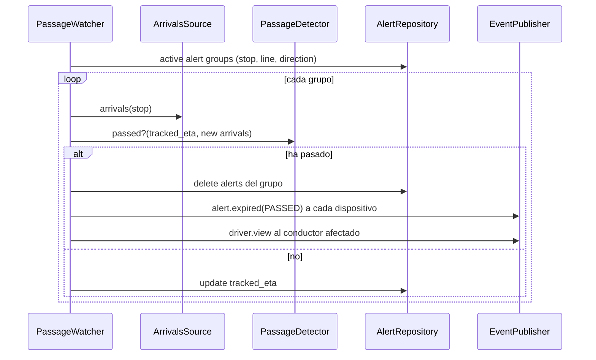

# Arquitectura — AvisaBus

> Estado: **APROBADO** (v1.0 · 2026-10-31). Deriva de `docs/vision.md`, `docs/requirements.md`
> y `docs/use_cases.md`. Las decisiones se registran como ADR en la sección 10.
> Los nombres de código están en inglés; ver glosario en `docs/conventions.md`.

## 1. Principios

1. **Hexagonal (puertos y adaptadores).** El dominio no conoce frameworks, HTTP, SQL ni el SAE.
2. **Fuentes de datos intercambiables.** Toda fuente externa (SAE, ocupación, GPS, reloj) entra por un puerto.
3. **Determinismo en tests.** Nada en los tests toca la red ni el reloj real.
4. **Privacidad por diseño.** Sin datos personales; lo efímero se borra al caducar.
5. **Simplicidad.** Un proceso, SQLite, eventos en memoria. Escalar es trabajo futuro.

## 2. Contexto (C4 nivel 1)



## 3. Contenedores (C4 nivel 2) y despliegue

Despliegue en **Raspberry Pi propia (SO de 64 bits, arm64)** con dominio propio y Docker Compose,
detrás del **Nginx Proxy Manager (NPM) ya existente** en la Raspberry.



- **Nginx Proxy Manager (externo al proyecto)**: termina TLS (HTTPS obligatorio para geolocalización y PWA) con un único *Proxy Host* para el dominio apuntando a `web:80`, con *Websockets Support* activado. El proyecto no gestiona certificados.
- **web**: contenedor `nginx:alpine` que sirve el build de React (con fallback a `index.html` para el router) y reenvía `/api` y `/ws` al backend por la red interna. Así NPM solo necesita un destino y la configuración de rutas vive versionada en el repositorio (`deploy/nginx/web.conf`).
- El servicio `web` se conecta a la red Docker de NPM (red externa declarada en `docker-compose.yml`, nombre configurable); `backend` solo está en la red interna del proyecto y no expone puertos.
- **backend**: un único proceso `uvicorn` (ADR-003). Contiene API REST, WebSockets, CLI (mismo paquete, otro punto de entrada) y tareas de fondo.
- **SQLite** en modo WAL sobre un volumen. Recomendado: almacenamiento en SSD/USB en lugar de la tarjeta SD (desgaste por escrituras).
- Imágenes multi-arquitectura (`linux/arm64` y `linux/amd64`) para desarrollar en el Mac y desplegar en la Raspberry.
- Configuración por variables de entorno con prefijo `AVISABUS_` (ver `.env.example`).

## 4. Backend: capas

```
backend/
├── pyproject.toml
├── src/avisabus/
│   ├── domain/                # Puro: sin I/O, sin frameworks
│   │   ├── models/            # Entidades y value objects (dataclasses frozen)
│   │   ├── services/          # Reglas: expiry, assignment, capacity, position_estimation,
│   │   │                      #         passage_detection, occupancy_level, direction_resolver
│   │   ├── ports/             # Protocols (interfaces) hacia el exterior
│   │   └── errors.py          # Excepciones de dominio
│   ├── application/           # Casos de uso (1 módulo por CU), orquestan dominio + puertos
│   ├── adapters/
│   │   ├── inbound/
│   │   │   ├── http/          # Routers FastAPI, esquemas Pydantic, mapeo de errores
│   │   │   ├── ws/            # Endpoints WebSocket
│   │   │   └── cli/           # Typer: gtfs, qr, driver-codes, simulate, sae-record
│   │   └── outbound/
│   │       ├── sae/           # http, cache, replay, recorder, scheduled_fallback
│   │       ├── persistence/   # SQLAlchemy + SQLite: network, alerts, driver sessions/codes
│   │       ├── occupancy/     # simulated sensor
│   │       ├── events/        # in-memory pub/sub
│   │       ├── security/      # HMAC stop tokens, code hashing, rate limiter
│   │       └── clock.py       # SystemClock
│   ├── background/            # PassageWatcher, AlertExpiryTicker, DriverSessionReaper
│   ├── config.py              # pydantic-settings
│   └── main.py                # Composition root: crea adaptadores e inyecta en casos de uso
└── tests/
    ├── unit/                  # domain + application con fakes
    ├── integration/           # adaptadores (SQLite temporal, replay SAE), API con TestClient
    └── fixtures/
        ├── gtfs_mini/         # GTFS reducido (2–3 líneas, ~20 paradas)
        └── sae_recordings/    # Respuestas SAE grabadas (JSON)
```

**Regla de dependencias** (verificada con import-linter):

```
adapters ──▶ application ──▶ domain
background ─▶ application
domain ──▶ (nada de avisabus fuera de domain)
```

Solo `main.py` (composition root) conoce las implementaciones concretas.

## 5. Modelo de dominio

```mermaid
classDiagram
  class Stop { stop_id: str; name: str; lat; lon }
  class Line { short_name: str; route_ids: set }
  class Direction { line: str; direction_id: int; headsign: str }
  class Shape { shape_id; points: list }
  class Arrival { line; destination; eta: timedelta|None; scheduled_at: time|None; source: REALTIME|SCHEDULED; in_network: bool }
  class EstimatedPosition { lat; lon; shape_distance_m; source: REALTIME|SCHEDULED }
  class Occupancy { capacity; occupied; free_seats; level: FREE|MEDIUM|FULL }
  class Alert { alert_id; stop_id; line; direction_id; needs: set~Need~; device_hash; created_at; status; tracked_eta; delivered_to: session_id|None }
  class Need { <<enum>> RAMP; EXTRA_TIME; SEAT }
  class AlertStatus { <<enum>> PENDING_DRIVER; DELIVERED; EXPIRED; CANCELLED }
  class DriverSession { session_id; code_id; line; direction_id; last_position; last_seen_at }
  class DriverCode { code_id; code_hash; revoked: bool }
  Alert --> Need
  Alert --> AlertStatus
  Line "1" --> "*" Direction
  Direction --> Shape
  DriverSession --> Direction
```



Notas:
- `Line` agrupa `route_id` por `route_short_name` (RF-03).
- `Alert.device_hash`: hash del identificador anónimo del dispositivo; nunca se guarda en claro.
- `Alert.tracked_eta`: último ETA observado del autobús asignado; base de la detección de paso (D12).
- Los avisos `EXPIRED`/`CANCELLED` se **borran** (RNF-06); los estados existen solo para emitir el evento final.

### Servicios de dominio clave

| Servicio | Responsabilidad | RF |
|---|---|---|
| `derive_directions` | El feed de EMT no trae `direction_id`: lo deriva al importar por línea, a partir de los extremos de cada trazado. Las circulares de EMT (C1, C2, C3) vienen partidas en medios viajes y se tratan igual ("hacia el destino de cada mitad"); la regla por orientación queda para feeds con el bucle en un solo viaje. Guarda todas las formas de cada sentido. | RF-03 |
| `DirectionResolver` | Traduce el `destino` del SAE a `direction_id` para una parada y línea. Si la línea solo pasa en un sentido por esa parada, es inmediato; si no, por coincidencia con los headsigns de los viajes que paran allí. | RF-11, RF-16 |
| `PositionEstimator` | Dado ETA a una parada y los tiempos programados entre paradas del viaje, sitúa el autobús sobre el shape (interpolación por distancia). | RF-12 |
| `OccupancyClassifier` | Convierte ocupación en nivel con umbrales configurables. | RF-15 |
| `AlertAssigner` | Asigna el aviso al próximo autobús (ETA mínimo) y al conductor conectado de esa línea y sentido más cercano aguas arriba de la parada. | RF-20, RF-23 |
| `PassageDetector` | Compara ETA previo y actual: paso si el ETA asignado desaparece o el primer ETA salta hacia arriba más de un umbral. | RF-21 |
| `ExpiryPolicy` | Paso por la parada, llegada a la siguiente o 30 min desde la creación. | RF-21 |
| `UpcomingStopsResolver` | Proyecta la posición GPS del conductor sobre el shape y devuelve las próximas N paradas; detecta desvío > 150 m. | RF-26 |
| `CapacityAlertPolicy` | Σ personas esperando en próximas paradas > plazas libres. | RF-29 |

## 6. Puertos y adaptadores

| Puerto (domain/ports) | Adaptadores | Notas |
|---|---|---|
| `ArrivalsSource` | `SaeHttpArrivalsSource`, `SaeReplayArrivalsSource` + decoradores `CachedArrivalsSource` (TTL 20 s), `RecordingArrivalsSource`, `ScheduledFallbackArrivalsSource` | La composición por defecto: Fallback(Cached(SaeHttp)). En tests: Replay. |
| `NetworkRepository` | `SqliteNetworkRepository` | Paradas, líneas, direcciones, shapes, horarios activos por fecha. |
| `AlertRepository` | `SqliteAlertRepository` | Persistente para sobrevivir a reinicios. |
| `DriverSessionRepository` | `SqliteDriverSessionRepository` | Posición solo la última; se borra al cerrar turno. |
| `DriverCodeRepository` | `SqliteDriverCodeRepository` | Hash `scrypt`. |
| `OccupancySensor` | `SimulatedOccupancySensor` | Determinista con semilla configurable. |
| `EventPublisher` | `InMemoryEventPublisher` | Pub/sub por canal (`device:<hash>`, `driver:<session>`). |
| `Clock` | `SystemClock`, `FakeClock` (tests) | Siempre `datetime` UTC con zona. |
| `StopTokenSigner` | `HmacStopTokenSigner` | Token = HMAC-SHA256(secret, stop_id) truncado, base64url. |

## 7. Superficie de la API

Prefijo `/api/v1`. JSON en `snake_case`. Errores en formato RFC 9457 (`application/problem+json`).
El cliente envía el identificador anónimo de dispositivo en la cabecera `X-Device-Id`.
El contrato es el OpenAPI generado por FastAPI; el frontend genera sus tipos a partir de él.

| Método | Ruta | Uso | CU |
|---|---|---|---|
| GET | `/stops/{stop_id}?t={token}` | Datos de parada y líneas | CU-01 |
| GET | `/stops/{stop_id}/arrivals?t={token}` | Llegadas + ocupación | CU-01 |
| GET | `/lines/{line}/directions/{direction_id}/shape` | Trazado GeoJSON | CU-02 |
| GET | `/stops/{stop_id}/lines/{line}/position?direction_id=` | Posición estimada | CU-02 |
| POST | `/alerts` | Crear aviso (`stop_id`, `token`, `line`, `direction_id`, `needs`) | CU-03 |
| GET | `/alerts/mine` | Avisos activos del dispositivo | CU-03 |
| DELETE | `/alerts/{alert_id}` | Cancelar | CU-04 |
| POST | `/driver/sessions` | Iniciar turno (`code`, `line`, `direction_id`) → token de sesión | CU-08 |
| PUT | `/driver/sessions/current/position` | Enviar posición GPS | CU-09 |
| DELETE | `/driver/sessions/current` | Finalizar turno | CU-10 |
| WS | `/ws/passenger` | Eventos de los avisos del dispositivo | CU-03/04/07 |
| WS | `/ws/driver` | Snapshot + eventos de la vista de conductor | CU-09 |

### Eventos (WebSocket)

| Evento | Canal | Contenido |
|---|---|---|
| `alert.registered` | pasajero | aviso creado, sin conductor |
| `alert.delivered` | pasajero | entregado a la vista del conductor |
| `alert.expired` | pasajero | motivo: `PASSED` \| `NEXT_STOP` \| `TIMEOUT` |
| `alert.cancelled` | pasajero | confirmación de cancelación |
| `driver.view` | conductor | snapshot completo: próximas paradas, avisos, plazas libres, alerta de capacidad, estado GPS |

La vista del conductor recibe siempre **snapshots completos** (no deltas): simplifica el cliente y la reconexión.

## 8. Tareas de fondo

| Tarea | Frecuencia | Función |
|---|---|---|
| `PassageWatcher` | cada 15 s | Para cada (parada, línea, sentido) con avisos activos, consulta `ArrivalsSource` (vía caché) y aplica `PassageDetector`. |
| `AlertExpiryTicker` | cada 10 s | Caduca avisos con más de 30 min. |
| `DriverSessionReaper` | cada 60 s | Cierra sesiones sin posición en 10 min. |
| `FeedValidityCheck` | al arrancar y diario | Avisa si el feed caduca en ≤ 7 días. |

Todas reciben el `Clock` inyectado y exponen un método `tick()` que los tests invocan directamente.

## 9. Secuencias principales

### Crear aviso (CU-03)



### Caducidad por paso del autobús (CU-07)



## 10. Frontend

```
frontend/src/
├── app/                 # Router, providers (QueryClient, i18n), layout
├── features/
│   ├── passenger/
│   │   ├── stop/        # Vista de parada y llegadas (CU-01)
│   │   ├── map/         # Mapa y posición estimada (CU-02)
│   │   ├── alerts/      # Crear/cancelar aviso, estado (CU-03/04)
│   │   └── profile/     # Perfil de accesibilidad local (CU-05)
│   └── driver/
│       ├── login/       # Código + línea/sentido (CU-08)
│       └── demand/      # Vista de demanda (CU-09/10)
├── shared/
│   ├── api/             # Cliente generado desde OpenAPI + hooks TanStack Query
│   ├── ws/              # Cliente WebSocket con reconexión
│   ├── device/          # Identificador anónimo (localStorage)
│   ├── i18n/            # Configuración i18next
│   └── ui/              # Componentes accesibles reutilizables
└── locales/
    ├── es/translation.json
    └── ca-valencia/translation.json
```

| Ruta | Vista |
|---|---|
| `/p/:stopId?t=:token` | Vista de parada (destino del QR) |
| `/p/:stopId/map/:line/:directionId` | Mapa |
| `/profile` | Perfil de accesibilidad |
| `/driver` | Acceso conductor |
| `/driver/shift` | Vista de demanda |

## 11. Decisiones de arquitectura (ADR)

| ADR | Decisión | Alternativas descartadas | Motivo |
|---|---|---|---|
| ADR-001 | Arquitectura hexagonal | MVC por capas | OBJ-08: sustituir fuentes sin tocar dominio |
| ADR-002 | SQLite (WAL) | PostgreSQL/PostGIS | Sin servidor; tests sin servicios; suficiente para el volumen |
| ADR-003 | Un proceso, eventos en memoria | Redis pub/sub, varios workers | RNF-12 (200 clientes) se cumple; menos piezas en la Raspberry |
| ADR-004 | ETA del SAE con caché 20 s y respaldo GTFS | Solo horario GTFS | Datos reales con uso respetuoso de una API no documentada |
| ADR-005 | Posición estimada por interpolación sobre shape | Simulación total; sin mapa | No existe feed público de posiciones |
| ADR-006 | Detección de paso solo con SAE | GPS del conductor | Igual comportamiento con o sin conductor; GPS como mejora futura |
| ADR-007 | Raspberry Pi + Docker Compose detrás del Nginx Proxy Manager existente; contenedor `web` (nginx) propio para estáticos y proxy interno | PaaS; Caddy | Infraestructura ya operativa del autor; TLS centralizado en NPM; rutas versionadas en el repo |
| ADR-008 | Código en inglés; documentación en castellano | Todo en castellano | Mejor encaje con librerías y agentes IA |
| ADR-009 | Snapshots completos a la vista del conductor | Deltas | Cliente simple, reconexión trivial |
| ADR-010 | Tipos del frontend generados desde OpenAPI | Tipos manuales | Contrato único entre backend y frontend |
| ADR-011 | Esquema con `create_all` y sin migraciones; datos de red versionados por `feed_version_id` con activación atómica | Alembic | Los datos de red son reimportables y los efímeros no necesitan migrarse; menos piezas |
| ADR-012 | Repositorios SQLite síncronos invocados desde casos de uso `async` | SQLAlchemy async / aiosqlite | Consultas locales de milisegundos; más simple de testear |
| ADR-013 | Identidad del autobús = viaje GTFS emparejado con el ETA (`TripMatcher`) | Identificador de vehículo | El SAE no publica vehículos; el viaje da una identidad estable para posición, ocupación y avisos |

## 12. Riesgos técnicos

| ID | Riesgo | Impacto | Mitigación |
|---|---|---|---|
| R-01 | El endpoint del SAE cambia o bloquea el acceso | Sin tiempos reales | Respaldo GTFS; grabaciones para demo; adaptador aislado |
| R-02 | El `destino` del SAE no casa con los headsign del GTFS; el feed no trae `direction_id` | Aviso con sentido erróneo | Sentidos derivados y validados por la persona (`gtfs info --directions`); `DirectionResolver` con todos los headsigns de la parada, normalización, alias y *overrides*; tests con grabaciones reales |
| R-03 | Recursos de la Raspberry (RAM/CPU) al importar `stop_times` (33 MB) | Importación lenta | Importación por lotes en streaming; importar en el Mac y copiar la BD si hace falta |
| R-04 | Caducidad mensual del feed GTFS | Horarios desfasados | RF-02 + comprobación diaria |
| R-05 | Desgaste de la tarjeta SD | Corrupción de BD | SSD/USB, WAL, copias de seguridad |
