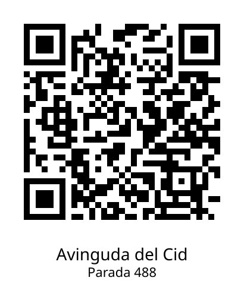
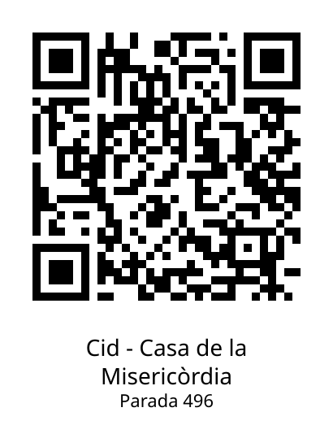
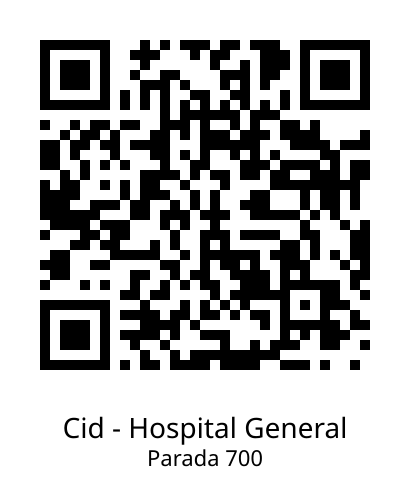
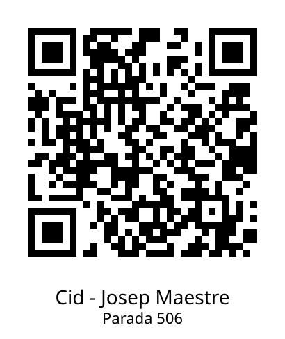
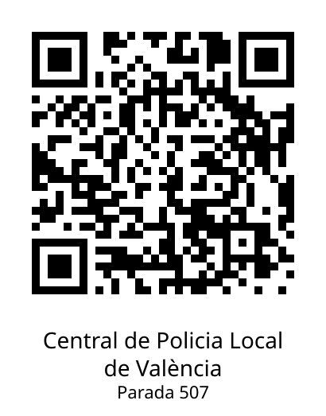
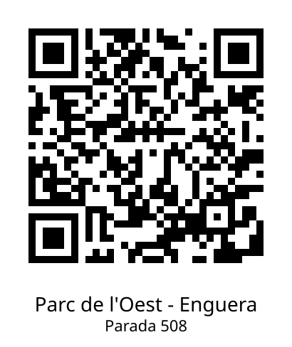

# QR de paradas de ejemplo

Estos son los QR de producción (<https://avisabus.yeddarpi.com>) de las siete primeras paradas de
la **línea 93 hacia Passeig Marítim - Hospital Malva-rosa**, en el orden del recorrido. Sirven
para probar la aplicación sin estar en la calle: se escanean con el móvil desde la pantalla o se
abre el enlace. El recorrido de prueba del [README](../../README.md#recorrido-de-prueba-sin-salir-a-la-calle)
usa la parada 496.

Se generaron con `avisabus qr generate --all` en el servidor (ver [CLI](../cli.md#qr-generate)).
Cada QR lleva debajo el nombre y el número de la parada. Las URL completas están en
[`index.csv`](index.csv).

| Orden | Parada | QR | Enlace |
|---|---|---|---|
| 1 | **488** · Avinguda del Cid (cabecera) |  | [Abrir](https://avisabus.yeddarpi.com/p/488?t=773z8Bl0dptt9BKw_F42PA) |
| 2 | **495** · Cid - Marconi |  | [Abrir](https://avisabus.yeddarpi.com/p/495?t=bpRq8JMtcc3tYBQPBgbOlw) |
| 3 | **496** · Cid - Casa de la Misericòrdia |  | [Abrir](https://avisabus.yeddarpi.com/p/496?t=Ax0NYP3h21fhTXhh-qMiJw) |
| 4 | **700** · Cid - Hospital General |  | [Abrir](https://avisabus.yeddarpi.com/p/700?t=3BCDBIJr4EOqJJ5b_2YeiA) |
| 5 | **506** · Cid - Josep Maestre |  | [Abrir](https://avisabus.yeddarpi.com/p/506?t=X_6R2fDQqPMcfySSth7Xtg) |
| 6 | **507** · Central de Policia Local de València |  | [Abrir](https://avisabus.yeddarpi.com/p/507?t=1UXMOuZxO_7jjTvQST3O1Q) |
| 7 | **508** · Parc de l'Oest - Enguera |  | [Abrir](https://avisabus.yeddarpi.com/p/508?t=sxwmzK9OmxYfepYFGFjNXQ) |

La parada 508 es también la de la sesión real grabada del SAE (`stop_508_peak`). Con
`AVISABUS_ARRIVALS_SOURCE=replay` es la que muestra llegadas en tiempo real.

Los tokens van firmados con el secreto del servidor (`AVISABUS_STOP_TOKEN_SECRET`). Si ese secreto
cambia, estos QR dejan de abrirse y hay que generarlos de nuevo.
