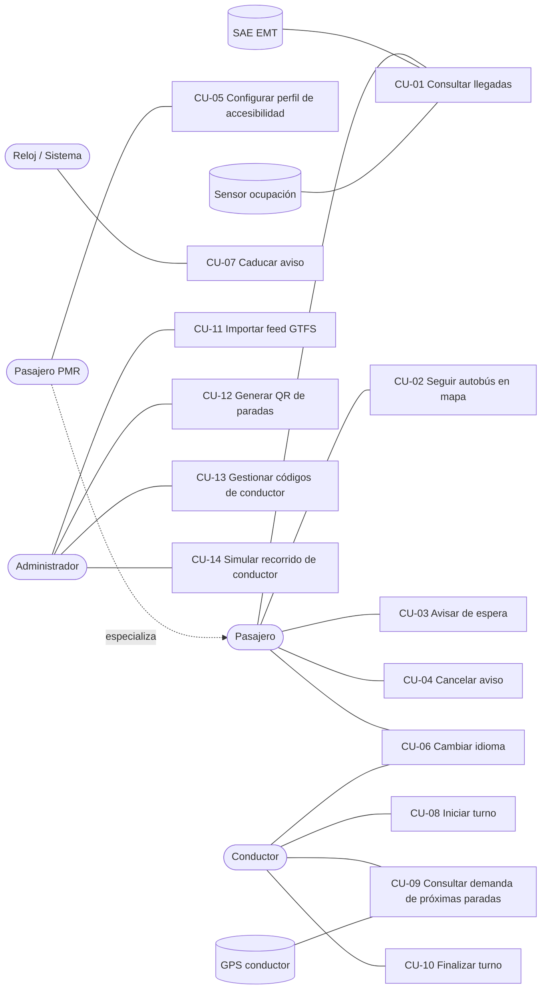

# Casos de uso — AvisaBus

> Estado: **APROBADO** (v1.0 · 2026-10-31). Deriva de `docs/vision.md` y `docs/requirements.md`.
> Cada caso de uso referencia los requisitos que cubre. Los flujos alternativos se numeran
> `<paso><letra>` (p. ej. `3a` es una alternativa al paso 3).

## Diagrama de contexto

## Resumen

| ID | Caso de uso | Actor principal | Requisitos |
|---|---|---|---|
| CU-01 | Consultar llegadas en una parada | Pasajero | RF-06–RF-11, RF-14, RF-15, RF-32 |
| CU-02 | Seguir el autobús en el mapa | Pasajero | RF-12, RF-13 |
| CU-03 | Avisar de que espero una línea | Pasajero / PMR | RF-16, RF-17, RF-19, RF-20, RF-23 |
| CU-04 | Cancelar un aviso | Pasajero | RF-22, RF-28 |
| CU-05 | Configurar perfil de accesibilidad | Pasajero PMR | RF-17, RF-18 |
| CU-06 | Cambiar idioma | Pasajero / Conductor | RF-31 |
| CU-07 | Caducar un aviso | Sistema (reloj) | RF-21, RF-28, RNF-06 |
| CU-08 | Iniciar turno | Conductor | RF-24, RF-25, RF-26 |
| CU-09 | Consultar demanda de próximas paradas | Conductor | RF-26–RF-29 |
| CU-10 | Finalizar turno | Conductor | RF-30, RNF-06 |
| CU-11 | Importar / actualizar feed GTFS | Administrador | RF-01–RF-04 |
| CU-12 | Generar QR de paradas | Administrador | RF-05 |
| CU-13 | Gestionar códigos de conductor | Administrador | RF-33 |
| CU-14 | Simular recorrido de conductor | Administrador (demo) | RF-34 |

> RF-35 (grabar/reproducir SAE) es una capacidad técnica de pruebas y no se modela como
> caso de uso; se especifica directamente en su feature.

---

## CU-01 Consultar llegadas en una parada

- **Actor principal:** Pasajero. **Actores secundarios:** SAE EMT, Sensor de ocupación.
- **Objetivo:** saber cuánto falta para que llegue cada línea y cómo de lleno viene el autobús.
- **Precondiciones:** feed GTFS importado; la parada tiene un QR generado (CU-12).
- **Disparador:** el pasajero escanea el QR de la parada.

**Flujo principal**
1. El pasajero escanea el QR; el navegador abre la URL de la parada.
2. El sistema valida el token de parada.
3. El sistema muestra el nombre de la parada (en valenciano) y las líneas que la sirven.
4. El sistema obtiene los tiempos de llegada (SAE, a través de caché).
5. El sistema muestra, por cada llegada: línea, destino, tiempo restante y nivel de ocupación (texto + icono + color) con indicación de asientos libres.
6. El sistema refresca los datos cada ≤ 30 s mientras la vista esté abierta.

**Flujos alternativos**
- **2a** Token inválido o parada inexistente → el sistema muestra "parada no encontrada" y no permite crear avisos. Fin.
- **4a** El SAE falla o no responde → el sistema muestra los próximos pasos según horario GTFS con la etiqueta "horario programado".
- **5a** El SAE devuelve una línea que no está en el GTFS (p. ej. nocturna) → se muestra con su tiempo, sin ocupación ni acceso al mapa.
- **5b** El SAE devuelve hora de llegada en lugar de minutos → se muestra la hora.
- **5c** No hay datos de ocupación para ese autobús → se muestra "ocupación no disponible".
- **5d** No hay llegadas previstas → "no hay llegadas previstas".

**Postcondiciones:** ninguna en el sistema (consulta). La respuesta del SAE queda en caché durante su TTL.

---

## CU-02 Seguir el autobús en el mapa

- **Actor principal:** Pasajero.
- **Objetivo:** ver por dónde circula el próximo autobús de una línea.
- **Precondiciones:** el pasajero está en la vista de parada (CU-01); la línea existe en el GTFS.
- **Disparador:** el pasajero pulsa "ver en el mapa" en una llegada.

**Flujo principal**
1. El sistema muestra un mapa con la parada, el trazado de la línea en ese sentido y la posición estimada del autobús, etiquetada "posición estimada".
2. El sistema actualiza la posición cada vez que se refresca el ETA.
3. El pasajero vuelve a la vista de parada.

**Flujos alternativos**
- **1a** No se puede estimar la posición (sin ETA, o ETA fuera del rango del horario) → se muestra el trazado y la parada con el mensaje "posición no disponible".
- **1b** El ETA proviene del horario programado (CU-01 4a) → la posición se marca como "posición según horario".

**Postcondiciones:** ninguna.

---

## CU-03 Avisar de que espero una línea

- **Actor principal:** Pasajero (o Pasajero PMR). **Actor secundario:** Conductor (receptor).
- **Objetivo:** que el conductor sepa que le espera, y con qué necesidades.
- **Precondiciones:** el pasajero está en la vista de una parada con token válido (CU-01); la línea está en el GTFS.
- **Disparador:** el pasajero pulsa "avisar" en una llegada.

**Flujo principal**
1. El pasajero pulsa "avisar" en la fila de la línea y destino deseados.
2. El sistema muestra las necesidades de accesibilidad precargadas del perfil (CU-05) y el botón "confirmar aviso".
3. El pasajero confirma.
4. El sistema registra el aviso (parada, línea, sentido, necesidades, identificador anónimo del dispositivo) y lo asigna al próximo autobús de esa línea y sentido.
5. El sistema entrega el aviso a la vista del conductor de ese autobús (CU-09).
6. El sistema muestra al pasajero "el conductor ha recibido tu aviso" y el estado del aviso activo.

**Flujos alternativos**
- **2a** El pasajero modifica las necesidades para este aviso → se usan las modificadas (el perfil no cambia salvo que lo guarde en CU-05).
- **4a** Ya existe un aviso activo del mismo dispositivo para esa parada y línea → el sistema muestra el aviso existente y no crea otro.
- **4b** Se supera el límite de avisos por dispositivo o IP → el sistema rechaza el aviso con un mensaje. Fin.
- **5a** No hay conductor conectado en esa línea y sentido → el sistema muestra "aviso registrado, sin conductor conectado". Si un conductor se conecta antes de que caduque, se le entrega y se actualiza la confirmación.

**Postcondiciones:** existe un aviso activo; el contador de la parada en la vista del conductor se incrementa.

---

## CU-04 Cancelar un aviso

- **Actor principal:** Pasajero.
- **Precondiciones:** el pasajero tiene un aviso activo.
- **Disparador:** el pasajero pulsa "cancelar aviso".

**Flujo principal**
1. El sistema elimina el aviso.
2. El sistema actualiza la vista del conductor (push).
3. El sistema confirma la cancelación al pasajero.

**Flujos alternativos**
- **1a** El aviso ya había caducado → el sistema informa de que no hay aviso activo.

**Postcondiciones:** el aviso no existe; sus datos de accesibilidad se han borrado.

---

## CU-05 Configurar perfil de accesibilidad

- **Actor principal:** Pasajero PMR.
- **Objetivo:** no tener que indicar sus necesidades en cada aviso.
- **Disparador:** el pasajero abre "mis necesidades".

**Flujo principal**
1. El sistema muestra las opciones: rampa, tiempo extra de subida, asiento.
2. El pasajero marca las que necesita y guarda.
3. El sistema guarda el perfil **solo en el dispositivo**.

**Flujos alternativos**
- **2a** El pasajero borra el perfil → se eliminan los datos del dispositivo.

**Postcondiciones:** los próximos avisos se precargan con el perfil. El servidor no almacena el perfil.

---

## CU-06 Cambiar idioma

- **Actor principal:** Pasajero o Conductor.
- **Flujo principal:**
  1. El actor selecciona castellano o valenciano.
  2. El sistema cambia todos los textos de la interfaz y recuerda la elección en el dispositivo.
- **Regla:** los nombres de paradas y líneas no se traducen (RF-32).
- **Flujo alternativo 0a:** primera visita → el idioma se toma del navegador (`ca*` → valenciano; resto → castellano).

---

## CU-07 Caducar un aviso

- **Actor principal:** Sistema (reloj / evento de paso).
- **Objetivo:** que no queden avisos obsoletos ni datos innecesarios.
- **Disparador:** se cumple alguna condición de caducidad.

**Flujo principal**
1. El sistema detecta que el autobús asignado ha pasado por la parada del aviso.
2. El sistema elimina el aviso y sus datos de accesibilidad.
3. El sistema actualiza la vista del conductor y la del pasajero ("tu autobús ha pasado").

**Flujos alternativos**
- **1a** El autobús asignado llega a la parada siguiente → igual que el flujo principal.
- **1b** Han pasado 30 minutos desde la creación → igual que el flujo principal ("tu aviso ha caducado").

**Detección de paso** (detalle en el `design.md` de la feature): **solo con datos del SAE**, haya o no conductor conectado. Se considera que el autobús asignado ha pasado por una parada cuando su ETA desaparece de la respuesta del SAE para esa parada o el primer ETA de la línea y destino salta al siguiente autobús. El sistema consulta el SAE de las paradas con avisos activos aunque ningún pasajero tenga la vista abierta.
*Trabajo futuro:* usar el GPS del conductor como fuente adicional de detección de paso.

**Postcondiciones:** el aviso no existe.

---

## CU-08 Iniciar turno

- **Actor principal:** Conductor.
- **Precondiciones:** el conductor tiene un código válido (CU-13).

**Flujo principal**
1. El conductor abre la vista de conductor e introduce su código.
2. El sistema valida el código.
3. El conductor selecciona línea y sentido.
4. El sistema solicita permiso de geolocalización y empieza a recibir la posición del dispositivo.
5. El sistema muestra la vista de demanda (CU-09).

**Flujos alternativos**
- **2a** Código inválido o revocado → mensaje de error; tras 5 intentos fallidos desde el mismo dispositivo/IP se bloquea durante 15 minutos.
- **4a** Permiso de geolocalización denegado → el sistema no puede determinar las próximas paradas y lo indica; se ofrece reintentar.
- **4b** La posición está a más de 150 metros del trazado de la línea y sentido elegidos → aviso "no estás en el recorrido de esta línea"; se mantiene la sesión.

**Postcondiciones:** existe una sesión de conductor asociada a línea y sentido.

---

## CU-09 Consultar demanda de próximas paradas

- **Actor principal:** Conductor. **Actor secundario:** GPS del dispositivo.
- **Precondiciones:** turno iniciado (CU-08).

**Flujo principal**
1. El sistema proyecta la posición del conductor sobre el trazado y determina sus próximas paradas.
2. El sistema muestra al menos las 3 próximas paradas con: nombre, número de personas esperando y avisos de accesibilidad destacados (rampa, tiempo extra, asiento).
3. El sistema muestra las plazas libres del autobús.
4. Ante cualquier aviso nuevo, cancelado o caducado, la vista se actualiza en tiempo real.
5. Al avanzar el autobús, las paradas superadas desaparecen y se incorporan las siguientes.

**Flujos alternativos**
- **2a** La suma de personas esperando en las próximas paradas supera las plazas libres → el sistema muestra una alerta de capacidad destacada (texto + icono + color).
- **2b** No hay avisos en las próximas paradas → "sin avisos".
- **1a** Se pierde la señal GPS más de 30 s → la vista indica "posición desactualizada" y mantiene la última lista.
- **4a** Se pierde la conexión con el servidor → indicador "sin conexión" y reconexión automática.

**Postcondiciones:** ninguna.

---

## CU-10 Finalizar turno

- **Actor principal:** Conductor.

**Flujo principal**
1. El conductor pulsa "finalizar turno".
2. El sistema cierra la sesión y elimina la posición del conductor.
3. Los avisos activos asignados a ese autobús pasan a "sin conductor conectado" (RF-23).

**Flujos alternativos**
- **1a** El conductor cierra la vista sin finalizar → la sesión expira tras 10 minutos sin recibir posición.

---

## CU-11 Importar / actualizar feed GTFS

- **Actor principal:** Administrador (CLI).

**Flujo principal**
1. El administrador ejecuta el comando de importación indicando el directorio o ZIP del feed.
2. El sistema valida que existan los ficheros obligatorios y sus columnas.
3. El sistema importa los datos en una versión nueva y la activa de forma atómica.
4. El sistema informa del resumen (líneas, paradas, viajes) y de la vigencia del feed.

**Flujos alternativos**
- **2a** Falta un fichero o columna obligatoria → error y se mantiene la versión anterior.
- **4a** El feed caduca en ≤ 7 días o ya ha caducado → advertencia.

---

## CU-12 Generar QR de paradas

- **Actor principal:** Administrador (CLI).

**Flujo principal**
1. El administrador ejecuta el comando indicando una parada, una lista o "todas".
2. El sistema genera para cada parada la URL con token firmado y su QR (PNG/SVG), con el nombre y código de parada impresos.

**Flujos alternativos**
- **1a** Código de parada inexistente → error para esa parada; se continúa con el resto.

---

## CU-13 Gestionar códigos de conductor

- **Actor principal:** Administrador (CLI).
- **Flujo principal:** el administrador crea un código (el sistema lo muestra una sola vez y guarda su hash), lista los existentes (sin mostrar el código) o revoca uno.
- **Flujo alternativo:** al revocar un código con sesión activa, esa sesión se cierra (CU-10).

---

## Limitaciones conocidas

| ID | Limitación | Consecuencia | Mitigación / trabajo futuro |
|---|---|---|---|
| LIM-01 | El SAE no identifica el vehículo concreto de cada ETA. | Si delante del conductor conectado circula otro autobús de la misma línea sin conductor conectado, un aviso puede entregarse al conductor equivocado. | Cruzar el ETA estimado desde el GPS del conductor con el ETA del SAE para elegir el vehículo más probable; integrar AVL/GTFS-RT real. |
| LIM-02 | La detección de paso depende de la frecuencia de consulta y de la exactitud del SAE. | Un aviso puede caducar con unos segundos de retraso o, si el SAE falla, solo por el tiempo máximo (30 min). | Usar el GPS del conductor como fuente adicional. |
| LIM-03 | La posición del autobús es estimada, no medida. | Puede desviarse de la real en tráfico irregular. | Se etiqueta como "posición estimada"; sustituible por AVL real vía adaptador. |
| LIM-04 | La ocupación es simulada. | No refleja la ocupación real. | Interfaz de sensor preparada para datos reales. |

---

## CU-14 Simular recorrido de conductor

- **Actor principal:** Administrador (demo / pruebas).

**Flujo principal**
1. El administrador ejecuta el simulador indicando línea, sentido, velocidad y código de conductor.
2. El simulador inicia un turno (CU-08) y emite posiciones a lo largo del trazado.
3. El sistema se comporta igual que con un conductor real (CU-09).
4. Al llegar al final del trazado, el simulador finaliza el turno (CU-10).
