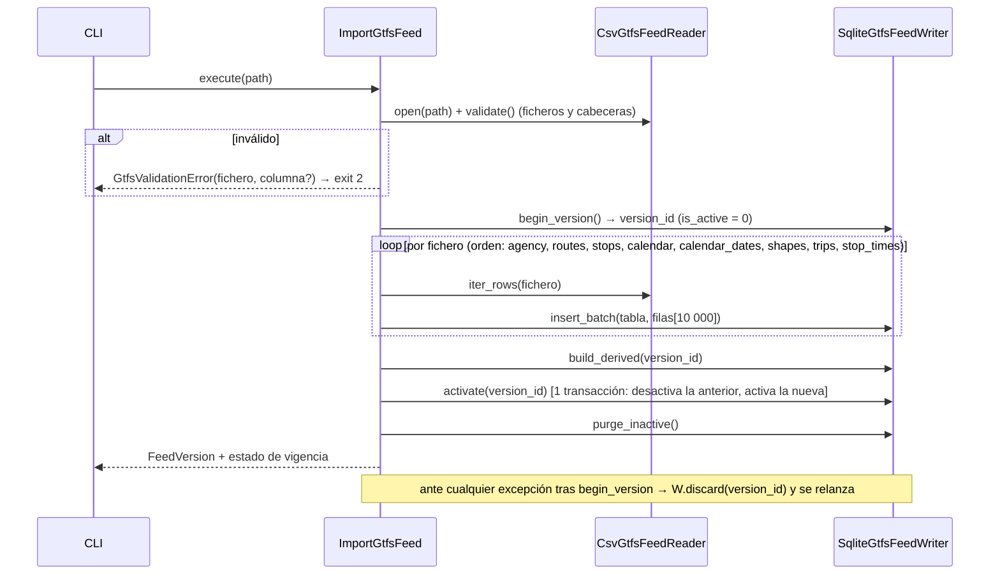

# Importación del GTFS — design

> Feature: `gtfs_import` · Versión: 1.1 · Estado: APPROVED
> Requisitos: RF-01, RF-02, RF-03, RF-04, RF-32 · Casos de uso: CU-11 · Depende de: project_scaffold

## 1. Resumen

Un importador en streaming lee el feed (directorio o ZIP), valida, inserta por lotes en SQLite
bajo un nuevo `feed_version_id`, calcula tablas derivadas y activa la versión en una
transacción. Todas las consultas filtran por la versión activa, de modo que los lectores ven
siempre una versión completa (SQLite en modo WAL permite leer mientras se escribe).

## 2. Componentes

| Capa | Módulo | Contenido |
|---|---|---|
| domain | `models/network.py` | `Stop`, `Line`, `LineDirection`, `ShapePoint`, `ScheduledStopTime`, `TripStopTime`, `FeedVersion` |
| domain | `services/service_calendar.py` | `active_services(date, calendars, exceptions) -> frozenset[str]` (puro) |
| domain | `services/gtfs_time.py` | `parse_gtfs_time("25:10:00") -> 90600`, `format_gtfs_time` |
| domain | `services/feed_validity.py` | `feed_validity_status(feed, today) -> Valid \| Expiring(days) \| Expired` |
| domain | `services/direction_derivation.py` | `derive_directions(patterns) -> Mapping[str, int]` (puro, §4.3) |
| domain | `ports/network.py` | `NetworkRepository` (Protocol) |
| application | `import_gtfs_feed.py` | `ImportGtfsFeed` (orquesta lector → escritor → activación) |
| application | `get_feed_info.py` | `GetFeedInfo` |
| application | `ports` locales | `GtfsFeedReader`, `GtfsFeedWriter` (Protocols en `domain/ports/gtfs_import.py`) |
| adapters/outbound | `gtfs/reader.py` | `CsvGtfsFeedReader` (dir o zip, UTF-8-sig, streaming) |
| adapters/outbound | `persistence/db.py` | `create_engine(settings)`, PRAGMAs, `metadata.create_all` |
| adapters/outbound | `persistence/network_tables.py` | Tablas SQLAlchemy Core |
| adapters/outbound | `persistence/sqlite_network.py` | `SqliteNetworkRepository`, `SqliteGtfsFeedWriter` |
| adapters/inbound | `cli/gtfs.py` | `avisabus gtfs import`, `avisabus gtfs info` |
| scripts | `backend/scripts/make_gtfs_mini.py` | Generador de la fixture |

## 3. Interfaces

```python
# domain/models/network.py  (todas @dataclass(frozen=True, slots=True))
class Stop:            stop_id: str; name: str; lat: float; lon: float
class Line:            short_name: str; long_name: str; color: str; text_color: str; route_ids: frozenset[str]
class LineDirection:   line: str; direction_id: int; headsign: str; color: str; text_color: str; shape_id: str
class ShapePoint:      lat: float; lon: float; sequence: int; dist_traveled: float | None
class ScheduledStopTime:
    trip_id: str; line: str; direction_id: int; headsign: str
    service_date: date          # día de servicio al que pertenece el viaje
    arrival_s: int              # segundos desde el inicio de service_date (puede ser ≥ 86400)
    stop_sequence: int
class TripStopTime:    stop_id: str; stop_sequence: int; arrival_s: int; departure_s: int; shape_dist_traveled: float | None
class HeadsignAtStop:  line: str; direction_id: int; headsign: str; trip_count: int
class FeedVersion:     version_id: int; feed_version: str | None; imported_at: datetime
                       start_date: date; end_date: date; counts: Mapping[str, int]

# domain/ports/network.py
class NetworkRepository(Protocol):
    def active_feed(self) -> FeedVersion | None: ...
    def get_stop(self, stop_id: str) -> Stop | None: ...
    def list_stop_ids(self) -> list[str]: ...
    def get_line(self, short_name: str) -> Line | None: ...
    def lines_at_stop(self, stop_id: str) -> list[LineDirection]: ...
    def headsigns_at_stop(self, stop_id: str, line: str) -> list[HeadsignAtStop]: ...
    def line_directions(self, line: str) -> list[LineDirection]: ...
    def shapes_for_direction(self, line: str, direction_id: int) -> list[tuple[str, int]]: ...
        # (shape_id, trip_count) ordenados por trip_count desc, shape_id asc
    def line_direction(self, line: str, direction_id: int) -> LineDirection | None: ...
    def active_service_ids(self, service_date: date) -> frozenset[str]: ...
    def scheduled_stop_times(self, stop_id: str, at: datetime, window: timedelta) -> list[ScheduledStopTime]: ...
    def trip_stop_times(self, trip_id: str) -> list[TripStopTime]: ...
    def shape_points(self, shape_id: str) -> list[ShapePoint]: ...
```

**Repositorios síncronos.** SQLite es local y las consultas son de milisegundos; los casos de
uso `async` los llaman directamente. Si una consulta superase ~20 ms, se envolverá en
`run_in_threadpool` (decisión de la feature que lo detecte).

`scheduled_stop_times(stop_id, at, window)`: `at` es tz-aware; se convierte a `Europe/Madrid`
(`agency_timezone`). Se consultan dos días de servicio: `D = at.date()` (segundos
`[s, s+window]`) y `D-1` (segundos `[s+86400, s+86400+window]`), cada uno con sus servicios
activos. El "inicio del día de servicio" es mediodía menos 12 h en hora local (definición GTFS).

### CLI

```
avisabus gtfs import PATH [--yes]     PATH = directorio o .zip
avisabus gtfs info [--directions]
```

`--directions` lista, por línea y sentido: origen del sentido (`feed`/`derived`), primera y
última parada del patrón principal, headsigns con su nº de viajes y nº de patrones. Sirve para
que una persona valide la derivación de sentidos.

Salida de `import` (texto, una línea por dato; cifras ilustrativas):

```
Feed importado (versión 3, feed_version 23-10-2026)
Vigencia: 2026-10-16 → 2026-11-22
Líneas: 42 · Paradas: 1117 · Viajes: 20 598 · Horarios de parada: 508 134
route_id sin viajes ignorados: 3
AVISO: el feed caduca en 5 días (2026-11-22)
```

Códigos de salida: `0` éxito, `1` sin feed (`info`), `2` error de validación o importación.

## 4. Datos

### 4.1 Columnas obligatorias / opcionales

| Fichero | Obligatorias | Opcionales usadas |
|---|---|---|
| agency.txt | agency_name, agency_timezone | agency_id |
| routes.txt | route_id, route_short_name, route_type | route_long_name, route_color, route_text_color, agency_id |
| stops.txt | stop_id, stop_name, stop_lat, stop_lon | stop_code |
| trips.txt | route_id, service_id, trip_id, shape_id | trip_headsign, direction_id |
| stop_times.txt | trip_id, arrival_time, departure_time, stop_id, stop_sequence | shape_dist_traveled |
| shapes.txt | shape_id, shape_pt_lat, shape_pt_lon, shape_pt_sequence | shape_dist_traveled |
| calendar.txt | service_id, monday…sunday, start_date, end_date | — |
| calendar_dates.txt | service_id, date, exception_type | — |
| feed_info.txt (opcional) | — | feed_version, feed_start_date, feed_end_date |

`shape_id` es opcional en GTFS pero **obligatorio para AvisaBus** (trazado). Si un viaje concreto
no tiene `trip_headsign`, se usa el nombre de la última parada del viaje. Ambos se recortan
(espacios al principio y al final), igual que los nombres (AC-07).

**Feed real de EMT (23-10-2026), cabeceras confirmadas:**

```
trips.txt       route_id,service_id,trip_id,trip_headsign,trip_short_name,shape_id
stop_times.txt  trip_id,arrival_time,departure_time,stop_id,stop_sequence,stop_headsign,shape_dist_traveled,timepoint
shapes.txt      shape_id,shape_pt_lat,shape_pt_lon,shape_pt_sequence,shape_dist_traveled
calendar.txt    service_id,monday,…,sunday,start_date,end_date
calendar_dates  service_id,date,exception_type
```

- **No hay `direction_id`** → el sentido se **deriva** al importar (§4.3).
- `shape_dist_traveled` está en `stop_times` y `shapes`, en **metros**.

### 4.3 Derivación del sentido

Si `trips.txt` trae `direction_id`, se usa tal cual (`direction_source = "feed"`). Si no
(caso de EMT), se deriva por línea comercial con la función pura
`derive_directions(patterns) -> Mapping[shape_id, int]` (`domain/services/direction_derivation.py`),
donde cada patrón es un `shape_id` con: primera y última parada (coordenadas), puntos de la forma
y número de viajes.

1. **Patrón de referencia** `R`: el de más viajes (empate → `shape_id` menor). `O` = primera
   parada de `R`, `D` = última parada de `R`.
2. **Línea lineal** (`distancia(O, D) ≥ 500 m`): para cada patrón `P`,
   `c_igual = d(P.primera, O) + d(P.última, D)` y `c_inverso = d(P.primera, D) + d(P.última, O)`;
   sentido `0` si `c_igual ≤ c_inverso`, si no `1`.
3. **Línea circular** (`distancia(O, D) < 500 m`): orientación de la forma por el signo del área
   (fórmula del polígono sobre coordenadas proyectadas equirrectangularmente); mismo signo que
   `R` → `0`, signo contrario → `1`. Si `|área|` es despreciable (< 1 000 m²) → `0` y log
   `gtfs.direction_ambiguous`.
4. Distancias: haversine en metros.

Resultado: `gtfs_trip.direction_id` (entero) y `gtfs_trip.direction_source` (`feed` | `derived`).
El sentido `0` de una línea es, por construcción, el de su patrón más frecuente.

**Líneas circulares en el feed de EMT (23-10-2026).** C1, C2 y C3 no vienen como un bucle
completo en un viaje, sino **partidas en medios viajes**, cada uno con su destino (p. ej. C2
"Plaça d'Espanya - Ermita" / "Blasco Ibáñez - Facultat de Geografia"); sus extremos están a
≥ 1 382 m, por lo que el paso 2 las trata como **lineales** y cada sentido significa "hacia el
destino de ese medio bucle", coherente con lo que muestra el autobús y con el cambio de viaje en
cada cabecera. En C2 y C3 un sentido agrupa medios bucles de los dos giros (formas distintas, sin
paradas comunes), de ahí `line_direction_shape`. La rama circular (paso 3) queda para feeds que
modelen el bucle completo en un viaje y solo se prueba con datos sintéticos.

**Desempate** del patrón de referencia: mayor número de viajes; empate → `shape_id` menor en orden
lexicográfico de cadena (p. ej. línea 59: `1070_2285_2437` < `1070_2437_2285`).

Los headsigns **no** definen el sentido (una línea puede tener variantes de recorrido con
headsigns distintos en el mismo sentido), pero se conservan todos: la tabla
`stop_line_headsign` guarda qué headsigns pasan por cada parada en cada sentido, que es lo que
usa `stop_arrivals_api` para interpretar el destino del SAE.

Colores: si faltan, `FE0000` / `FFFFFF` (los del feed actual).

### 4.2 Tablas (SQLAlchemy Core; todas con `feed_version_id INTEGER NOT NULL`)

| Tabla | Columnas (además de `feed_version_id`) | Índices |
|---|---|---|
| `feed_version` | `id PK`, `feed_version`, `imported_at`, `start_date`, `end_date`, `is_active`, `counts_json`, `timezone` | parcial único `is_active=1` |
| `gtfs_stop` | `stop_id`, `name`, `lat`, `lon` | PK (fv, stop_id) |
| `gtfs_route` | `route_id`, `short_name`, `long_name`, `color`, `text_color` | PK (fv, route_id) |
| `gtfs_trip` | `trip_id`, `route_id`, `line`, `service_id`, `direction_id`, `direction_source`, `headsign`, `shape_id` | PK (fv, trip_id); (fv, line, direction_id) |
| `gtfs_stop_time` | `trip_id`, `stop_sequence`, `stop_id`, `arrival_s`, `departure_s`, `shape_dist` | PK (fv, trip_id, stop_sequence); (fv, stop_id, arrival_s) |
| `gtfs_shape_point` | `shape_id`, `sequence`, `lat`, `lon`, `dist` | PK (fv, shape_id, sequence) |
| `gtfs_calendar` | `service_id`, `mon`…`sun`, `start_date`, `end_date` | PK (fv, service_id) |
| `gtfs_calendar_date` | `service_id`, `date`, `exception_type` | PK (fv, service_id, date) |
| `line` | `short_name`, `long_name`, `color`, `text_color` | PK (fv, short_name) |
| `line_route` | `short_name`, `route_id` | PK (fv, route_id) |
| `line_direction` | `short_name`, `direction_id`, `headsign`, `shape_id`, `trip_count` | PK (fv, short_name, direction_id) |
| `stop_line_direction` | `stop_id`, `short_name`, `direction_id` | PK (fv, stop_id, short_name, direction_id) |
| `line_direction_shape` | `short_name`, `direction_id`, `shape_id`, `trip_count` | PK (fv, short_name, direction_id, shape_id) |
| `stop_line_headsign` | `stop_id`, `short_name`, `direction_id`, `headsign`, `trip_count` | PK (fv, stop_id, short_name, direction_id, headsign) |

`gtfs_trip.line` se rellena al importar (`route_short_name` del `route_id`) para evitar joins.

**Esquema:** `metadata.create_all()` al arrancar; sin migraciones. Los datos de red son
reimportables y los datos efímeros (avisos, sesiones) no necesitan conservarse entre cambios de
esquema incompatibles: en ese caso se recrea la base de datos (ADR-011).

PRAGMAs al conectar: `journal_mode=WAL`, `synchronous=NORMAL`, `foreign_keys=ON`,
`busy_timeout=5000`.

## 5. Flujo de importación



Derivados (`build_derived`):
1. `line`: por `short_name`, **solo si tiene al menos un viaje**; atributos del `route_id` con más
   viajes. Los `route_id` sin viajes se ignoran y se cuentan (`ignored_route_ids`) para el resumen.
2. `line_route`.
3. **Sentidos** (si el feed no trae `direction_id`): se cargan los patrones por línea (`shape_id`,
   primera/última parada de un viaje representativo del patrón, puntos de la forma, nº de viajes),
   se llama a `derive_directions` y se actualiza `gtfs_trip.direction_id` por `shape_id`.
4. `line_direction`: por (`line`, `direction_id`), `headsign` y `shape_id` con más viajes
   (empate → orden alfabético).
4b. `line_direction_shape`: por (`line`, `direction_id`, `shape_id`) con su número de viajes.
5. `stop_line_direction`: `SELECT DISTINCT stop_id, line, direction_id` de `stop_time ⋈ trip`.
6. `stop_line_headsign`: `SELECT stop_id, line, direction_id, headsign, COUNT(DISTINCT trip_id)`
   de `stop_time ⋈ trip` agrupado.

## 6. Errores

| Situación | Excepción (application) | CLI |
|---|---|---|
| Fichero obligatorio ausente | `GtfsValidationError(file=…)` | exit 2, `ERROR: falta stops.txt` |
| Columna obligatoria ausente | `GtfsValidationError(file=…, column=…)` | exit 2 |
| Valor inválido (hora, número, fecha) | `GtfsDataError(file, line_number, detail)` | exit 2, versión descartada |
| Ruta inexistente / ZIP corrupto | `GtfsValidationError` | exit 2 |

## 7. Configuración

| Variable | Default | Uso |
|---|---|---|
| `AVISABUS_DATABASE_URL` | (scaffold) | BD SQLite |
| `AVISABUS_GTFS_EXPIRY_WARNING_DAYS` | `7` | Umbral de AC-19 |
| `AVISABUS_GTFS_BATCH_SIZE` | `10000` | Tamaño de lote |

## 8. Estrategia de test

- **Unit:** `parse_gtfs_time` (AC-08), `active_services` con tabla de casos (AC-14),
  `feed_validity_status` con fechas (AC-19, AC-20), normalización de nombres (AC-07),
  `derive_directions` con patrones sintéticos: lineal ida/vuelta, variante corta en el mismo
  sentido, circular en ambos giros, circular degenerada (AC-23–AC-25).
- **Integration** (BD SQLite en `tmp_path`, fixture `gtfs_mini`): importación completa (AC-01),
  zip creado en `tmp_path` (AC-02), copias de la fixture con fichero/columna eliminados
  (AC-03/04), lector con fallo inyectado (AC-05), doble importación (AC-06), consultas del
  repositorio (AC-09–AC-17), CLI con `CliRunner` + `FakeClock` inyectado (AC-18, AC-19).
- **Slow (manual):** importación del feed real `data/gtfs/emt/` (AC-22), marcada
  `@pytest.mark.slow` y omitida si no existe el directorio.
- Inyección del reloj en la CLI: la CLI obtiene sus dependencias de una función
  `build_cli_container(settings, clock)` que los tests sobrescriben.

### Fixture `gtfs_mini`

`backend/scripts/make_gtfs_mini.py --src data/gtfs/emt --lines 70,93,98,C2 --date 2026-11-04 --out backend/tests/fixtures/gtfs_mini`:
- conserva `agency`, `feed_info`, las rutas de esas líneas, sus viajes cuyos servicios estén
  activos en `--date` o en `--date - 1 día`, sus `stop_times`, las paradas y formas referenciadas,
  y las filas de `calendar`/`calendar_dates` de esos servicios;
- incluye la parada **508** (servida por 70 y 93) y la **2070** (servida por la 98);
- la 98 aporta una variante corta en el mismo sentido (`1054_487_2229`) y dos `route_id`; C2, dos
  `route_id` con medios bucles de giro opuesto;
- objetivo de tamaño: < 2 MB en total (estimado en E-01: ≈ 1,40 MB).

## 9. Decisiones locales permitidas

- Implementación interna del lector (módulo `csv` estándar recomendado).
- Mensajes exactos de la CLI salvo los indicados.
- Índices adicionales si mejoran consultas medidas.

## 10. Preguntas abiertas

Ninguna. (Las cabeceras del feed real se confirmaron el 2026-10-31; la exploración E-01 valida
la derivación de sentidos sobre el feed completo.)
