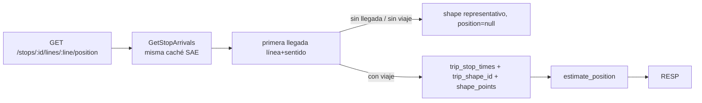

# Estimación de la posición del autobús — design

> Feature: `position_estimation` · Versión: 1.0 · Estado: DRAFT
> Requisitos: RF-12, RNF-01 · Casos de uso: CU-02 · Depende de: gtfs_import, stop_arrivals_api

## 1. Resumen



## 2. Componentes

| Capa | Módulo | Contenido |
|---|---|---|
| domain | `models/position.py` | `PositionStatus`, `PositionEstimate`, `ShapeView` |
| domain | `services/geometry.py` | `haversine_m`, `cumulative_distances`, `point_at_distance`, `bearing_deg`, `project_onto_shape` |
| domain | `services/position_estimator.py` | `estimate_position(...)` |
| domain | `ports/network.py` | Ampliación: `trip_shape_id`, `shape_stops` |
| application | `get_vehicle_position.py` | `GetVehiclePosition` |
| application | `get_shape.py` | `GetShape` |
| adapters/outbound | `persistence/sqlite_network.py` | Implementación de las ampliaciones |
| adapters/inbound | `http/routes/position.py`, `http/routes/shapes.py` | Endpoints |
| adapters/inbound | `http/app.py` | `GZipMiddleware(minimum_size=1000)` |

## 3. Interfaces

```python
# domain/models/position.py
class PositionStatus(StrEnum):
    EN_ROUTE = "EN_ROUTE"; AT_STOP = "AT_STOP"; NOT_STARTED = "NOT_STARTED"
    NO_VEHICLE = "NO_VEHICLE"; NO_ARRIVAL = "NO_ARRIVAL"

@dataclass(frozen=True, slots=True)
class StopRef:
    stop_id: str
    name: str

@dataclass(frozen=True, slots=True)
class PositionEstimate:
    status: PositionStatus            # EN_ROUTE | AT_STOP | NOT_STARTED
    lat: float
    lon: float
    bearing_deg: float | None
    shape_distance_m: float
    distance_to_stop_m: float
    stops_away: int                   # paradas intermedias antes de la objetivo (0 = la siguiente es la tuya)
    next_stop: StopRef

@dataclass(frozen=True, slots=True)
class ShapeStop:
    stop_id: str; name: str; lat: float; lon: float; sequence: int

@dataclass(frozen=True, slots=True)
class ShapeView:
    shape_id: str
    line: str
    color: str | None
    coordinates: tuple[tuple[float, float], ...]   # (lon, lat)
    stops: tuple[ShapeStop, ...]
    feed_version_id: int
```

```python
# domain/services/position_estimator.py
def estimate_position(
    stop_times: Sequence[TripStopTime],      # del viaje, ordenados por stop_sequence
    shape: Sequence[ShapePoint],             # ordenados por sequence
    stop_names: Mapping[str, str],
    target_stop_id: str,
    service_day_start: datetime,             # tz-aware: mediodía − 12 h, Europe/Madrid, del service_date
    arrival_at: datetime,                    # tz-aware UTC
    now: datetime,                           # tz-aware UTC
) -> PositionEstimate | None:                # None si el viaje no contiene la parada objetivo
    ...
```

Algoritmo:
1. Distancias de la forma: `dist_traveled` o `cumulative_distances(shape)` (AC-06).
2. Distancias de paradas: `shape_dist_traveled` o `project_onto_shape` con restricción monótona
   (cada parada se proyecta sobre el tramo de forma posterior a la anterior) (AC-06).
3. Parada objetivo `k`: aparición de `target_stop_id` con `|sched_k − arrival_at|` mínimo (AC-07).
4. `δ = arrival_at − sched_k`; `s = (now − δ − service_day_start).total_seconds()`.
5. `s ≤ arrival_s[0]` → `NOT_STARTED`, `d = d_0`; `s ≥ arrival_s[k]` → `AT_STOP`, `d = d_k`;
   en otro caso, el `i < k` con `s_i ≤ s < s_{i+1}` → `EN_ROUTE`, `d` por AC-01. Para `s_i` se
   usa `departure_s` de la parada `i` y para `s_{i+1}` el `arrival_s` de la `i+1`.
6. `point_at_distance(shape, d)` → `lat`, `lon`, `bearing_deg` del segmento (AC-05).
7. `distance_to_stop_m = max(0, d_k − d)`; `next_stop` = primera parada `j ≤ k` con `d_j > d`
   (o la `k` si `AT_STOP`); `stops_away` = nº de paradas `j` con `d < d_j` y `j < k` (AC-08).

```python
# domain/ports/network.py — ampliación
def trip_shape_id(self, trip_id: str) -> str | None: ...
def shape_stops(self, shape_id: str) -> list[ShapeStop]: ...   # del viaje con más viajes de esa forma (empate: trip_id menor)
def shape_line(self, shape_id: str) -> Line | None: ...
```

```python
# application/get_vehicle_position.py
@dataclass(frozen=True, slots=True)
class VehiclePosition:
    stop: Stop
    line: str
    direction_id: int
    source: ArrivalSource
    status: PositionStatus
    generated_at: datetime
    refresh_after_s: int
    arrival: ArrivalView | None
    shape_id: str | None
    estimate: PositionEstimate | None

class GetVehiclePosition:
    def __init__(self, stop_arrivals: GetStopArrivals, network: NetworkRepository, clock: Clock) -> None: ...
    async def execute(self, stop_id: str, token: str, line: str, direction_id: int) -> VehiclePosition: ...
    # lanza StopNotFoundError, NoActiveFeedError, LineNotAtStopError
```

### API

`GET /api/v1/stops/{stop_id}/lines/{line}/position?direction_id=0&t=…`

```json
{
  "stop": {"stop_id": "508", "name": "Parc de l'Oest - Enguera", "lat": 39.46794, "lon": -0.39568},
  "line": "93", "direction_id": 0,
  "source": "REALTIME", "status": "EN_ROUTE",
  "generated_at": "2026-11-04T07:40:00Z", "refresh_after_s": 20,
  "arrival": {"kind": "MINUTES", "minutes": 4, "arrival_at": "2026-11-04T07:44:00Z"},
  "vehicle": {"trip_id": "…", "service_date": "2026-11-04"},
  "shape_id": "994_…",
  "position": {
    "lat": 39.4701, "lon": -0.3901, "bearing_deg": 245.0,
    "distance_to_stop_m": 850, "stops_away": 3,
    "next_stop": {"stop_id": "512", "name": "…"}
  }
}
```

`distance_to_stop_m` se redondea a metros enteros; `lat`/`lon` a 6 decimales.

`GET /api/v1/shapes/{shape_id}`

```json
{
  "shape_id": "994_…", "line": "93", "color": "FE0000",
  "coordinates": [[-0.3318, 39.4474], [-0.3319, 39.4475]],
  "stops": [{"stop_id": "1585", "name": "…", "lat": 39.44, "lon": -0.33, "sequence": 1}]
}
```

`ETag: "<feed_version_id>-<shape_id>"`; `Cache-Control: public, max-age=86400`.

Errores (`problem+json`):

| Caso | status | type |
|---|---|---|
| Token / parada | 404 | `…/stop-not-found` (idéntico a `stop_arrivals_api`) |
| Línea y sentido no pasan por la parada | 404 | `…/line-not-at-stop` |
| Forma inexistente | 404 | `…/shape-not-found` |
| Sin feed | 503 | `…/network-unavailable` |

> Cambio respecto a `docs/architecture.md` §7: el trazado se sirve por `shape_id`
> (`/shapes/{shape_id}`) en lugar de por línea y sentido, porque el viaje concreto puede usar una
> variante de recorrido. La tabla de la arquitectura se actualiza en esta misma PR de specs.

Tras implementar los endpoints, se regenera `frontend/src/shared/api/openapi.json` y
`schema.d.ts` con `npm run gen:api` (el test de desfase de `passenger_stop_view` lo exige si ya
existe).

## 4. Datos

Sin tablas nuevas. `shape_stops` y `trip_shape_id` se resuelven con consultas sobre `gtfs_trip`
y `gtfs_stop_time` de la versión activa (índice existente `(fv, trip_id)`; si `shape_stops`
supera 20 ms, se añade índice `(fv, shape_id)` en `gtfs_trip` — decisión local permitida).

## 5. Estrategia de test

| AC | Test |
|---|---|
| AC-01–AC-08 | `tests/unit/test_position_estimator.py` y `test_geometry.py`: viaje sintético rectilíneo de 5 paradas cada 1000 m y 120 s; casos con retraso, extremos, circular (parada repetida), sin `shape_dist_traveled` |
| AC-09–AC-12 | `tests/integration/test_position_api.py` (BD `gtfs_mini`, replay, `FakeClock`; contador de llamadas a la fuente de llegadas para AC-09) |
| AC-13–AC-16 | `tests/integration/test_shapes_api.py` (incluye `If-None-Match` y `Accept-Encoding: gzip`) |
| AC-17 | `tests/integration/test_position_real_session.py`: recorre la sesión `stop_508_peak` avanzando el `FakeClock` cada 20 s |

## 6. Decisiones locales permitidas

- Índice adicional para `shape_stops` (ver §4).
- Implementación concreta de la proyección sobre la forma (manteniendo la monotonía).

## 7. Preguntas abiertas

Ninguna.
