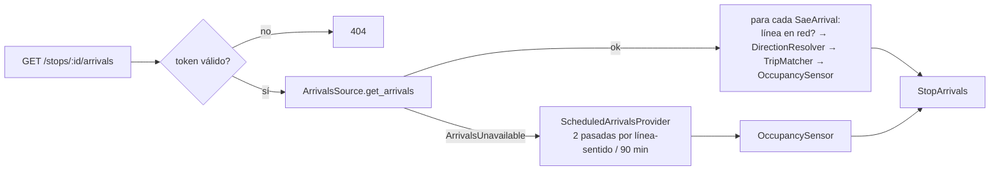

# API de parada y llegadas — design

> Feature: `stop_arrivals_api` · Versión: 1.5 · Estado: APPROVED
> Requisitos: RF-06, RF-09, RF-11, RF-15, RF-32, RNF-01, RNF-08 · Casos de uso: CU-01 · Depende de: gtfs_import, stop_tokens_qr, sae_arrivals_source, occupancy_sensor

## 1. Resumen



## 2. Componentes

| Capa | Módulo | Contenido |
|---|---|---|
| domain | `models/stop_arrivals.py` | `ArrivalSource`, `VehicleView`, `ArrivalView`, `StopArrivals`, `StopView` |
| domain | `services/direction_resolver.py` | `resolve_direction(...)`, `normalize_destination(...)`, `DEFAULT_ALIASES` |
| domain | `services/trip_matcher.py` | `match_trips(...)` |
| application | `get_stop.py` | `GetStop` |
| application | `get_stop_arrivals.py` | `GetStopArrivals` |
| application | `scheduled_arrivals.py` | `ScheduledArrivalsProvider` |
| adapters/inbound | `http/routes/stops.py` | Endpoints y esquemas Pydantic |
| adapters/inbound | `http/errors.py` | Mapeo `StopNotFoundError` → 404, `NoActiveFeedError` → 503 |
| main | `main.py` | Composición |

## 3. Interfaces

```python
# domain/models/stop_arrivals.py
class ArrivalSource(StrEnum):
    REALTIME = "REALTIME"; SCHEDULED = "SCHEDULED"

@dataclass(frozen=True, slots=True)
class VehicleView:
    trip_id: str
    service_date: date

@dataclass(frozen=True, slots=True)
class ArrivalView:
    line: str
    destination: str
    direction_id: int | None
    in_network: bool
    kind: ArrivalKind
    minutes: int | None
    arrival_at: datetime
    line_color: str | None
    line_text_color: str | None
    sae_destination: str | None       # texto del SAE tal cual; None si SCHEDULED (AC-21)
    vehicle: VehicleView | None
    occupancy: OccupancyStatus | None
    can_alert: bool

@dataclass(frozen=True, slots=True)
class StopView:
    stop_id: str
    name: str
    lines: tuple[LineDirection, ...]

@dataclass(frozen=True, slots=True)
class StopArrivals:
    stop_id: str
    source: ArrivalSource
    generated_at: datetime
    refresh_after_s: int
    arrivals: tuple[ArrivalView, ...]
```

```python
# domain/services/direction_resolver.py
@dataclass(frozen=True, slots=True)
class DirectionCandidate:
    direction_id: int
    headsign: str

def normalize_destination(text: str, aliases: Mapping[str, str]) -> frozenset[str]: ...
    # casefold → NFKD sin diacríticos → no alfanumérico = espacio → tokens
    # → cada token sustituido por aliases.get(token, token) → descarta tokens vacíos

def resolve_direction(destination: str, candidates: Sequence[DirectionCandidate],
                      aliases: Mapping[str, str], min_score: float = 0.2,
                      override_headsign: str | None = None,
                      departing_directions: frozenset[int] = frozenset()) -> int | None: ...
    # candidates = un elemento por (direction_id, headsign) de headsigns_at_stop(stop, line);
    #              un mismo sentido puede aparecer varias veces (variantes de recorrido).
    # Orden de resolución (v1.4):
    # 1. 0 candidatos → None; todos del mismo direction_id → ese direction_id (AC-05)
    # 2. override_headsign (ya buscado por "línea|destino SAE") → sentido del candidato con ese
    #    headsign; si ninguno lo tiene, se ignora el override (AC-20)
    # 3. texto: score(headsign) = |A∩B| / |A∪B| (Jaccard sobre conjuntos normalizados), contando
    #    también como coincidencia los pares de tokens en que uno es prefijo del otro con longitud
    #    ≥ 3, emparejados **1 a 1** de forma voraz (cada token se usa una sola vez);
    #    best[d] = máximo score de los headsigns del sentido d;
    #    gana d* si best[d*] ≥ min_score y best[d*] > best[d] para todo d ≠ d* (AC-06)
    # 4. sentido que sale: si departing_directions (sentidos cuyos viajes EMPIEZAN en la parada)
    #    tiene exactamente un elemento y está entre los candidatos → ese (AC-19)
    # 5. None (AC-07)

DEFAULT_ALIASES = {
    # abreviaturas
    "pass": "passeig", "pg": "passeig", "est": "estacio", "av": "avinguda", "avda": "avinguda",
    "pl": "placa", "hosp": "hospital", "univ": "universitats", "pta": "porta", "fta": "fonteta",
    "s": "sant", "ed": "eduard", "j": "joaquin",
    # palabras vacías → "" (se descartan)
    "de": "", "d": "", "del": "", "dels": "", "la": "", "l": "", "el": "", "els": "",
    "les": "", "i": "", "y": "",
}
# v1.4: se elimina "c": "carrer" ("C. Benlloch" = Cardenal, "C.Art.Faller" = Ciutat de l'Artista Faller)
```

La tabla de alias y los *overrides* pueden ampliarse con casos nuevos (decisión local permitida:
añadir entradas, con un test que las cubra); quitar entradas o cambiar el algoritmo requiere una
versión nueva de la spec.

```python
# domain/services/trip_matcher.py
@dataclass(frozen=True, slots=True)
class TripCandidate:
    trip_id: str
    service_date: date
    scheduled_at: datetime        # tz-aware UTC

def match_trips(arrival_times: Sequence[datetime], candidates: Sequence[TripCandidate],
                tolerance: timedelta) -> list[TripCandidate | None]: ...
    # v1.4 (AC-10): para las llegadas de la MISMA línea y sentido, ordenadas por tiempo, elegir la
    # asignación que (1) maximiza el nº de llegadas emparejadas, (2) a igualdad minimiza
    # Σ|scheduled_at − t|, (3) usa cada candidato una vez, (4) es estrictamente creciente en
    # scheduled_at, (5) solo usa pares con |scheduled_at − t| ≤ tolerance.
    # Desempate final determinista: lexicográfico por trip_id de las asignaciones.
    # Tamaño real: ≤ 2–4 llegadas por línea y sentido (QR.php muestra 2 por línea) y pocos
    # candidatos: basta con programación dinámica tipo alineamiento de secuencias o fuerza bruta.
    # Llegadas duplicadas (AC-22) son elementos distintos de la secuencia.
```

```python
# application/get_stop_arrivals.py
class GetStopArrivals:
    def __init__(self, network: NetworkRepository, signer: StopTokenSigner,
                 arrivals: ArrivalsSource, scheduled: ScheduledArrivalsProvider,
                 occupancy: OccupancySensor, thresholds: OccupancyThresholds, clock: Clock,
                 refresh_after_s: int, match_tolerance: timedelta,
                 aliases: Mapping[str, str], direction_overrides: Mapping[tuple[str, str], str],
                 min_score: float,
                 logger: Logger) -> None: ...
    async def execute(self, stop_id: str, token: str) -> StopArrivals: ...
    # lanza StopNotFoundError (token inválido o parada inexistente) y NoActiveFeedError

# application/scheduled_arrivals.py
class ScheduledArrivalsProvider:
    def __init__(self, network: NetworkRepository, window: timedelta = timedelta(minutes=90),
                 per_direction: int = 2) -> None: ...
    def next_arrivals(self, stop_id: str, now: datetime) -> list[ScheduledStopTime]: ...
```

**Días de servicio consultados (v1.2, AC-18):** `NetworkRepository.scheduled_stop_times(stop_id,
at, window)` debe devolver las pasadas de **todos** los días de servicio entre `fecha(at) − 1` y
`fecha(at + window)` (zona del feed). La implementación de `gtfs_import` solo cubría `D − 1` y `D`;
se amplía en esta feature (T-05b), sin cambiar la firma.

**Sentidos que salen (v1.4, AC-19):** ampliación de `NetworkRepository` (código de
`gtfs_import`, autorizada por T-05c): `departing_directions(stop_id, line) -> frozenset[int]`,
sentidos de la línea con algún viaje activo en la red cuyo `stop_sequence` mínimo está en esa
parada. Se puede precalcular al importar o consultar sobre `gtfs_stop_time`/`gtfs_trip` (decisión
local permitida, con índice si supera 20 ms).

**Overrides (v1.4, AC-20):** el fichero contiene `"{línea}|{destino SAE exacto}": "{headsign
GTFS}"`. Al arrancar se valida cada entrada contra la red activa (línea existente y headsign
existente en algún sentido de esa línea); las inválidas se registran (`arrivals.override_invalid`)
y se ignoran. En cada consulta, `GetStopArrivals` busca `(line, destination)` y pasa el headsign a
`resolve_direction`, que lo traduce al sentido con los candidatos de esa parada.

**Headsign devuelto (v1.5, AC-09):** `resolve_destination(...) -> DestinationResolution | None`
devuelve el sentido y el headsign: con sentido único, el headsign más frecuente de ese sentido en
la parada; con *override*, el del *override*; con texto o sentido que sale, el headsign de ese
sentido con mayor similitud al texto del SAE (empate: el más frecuente). `GetStopArrivals` usa
`destination = resolution.headsign` si hay resolución y el texto del SAE si no;
`sae_destination` es siempre el texto del SAE (y `None` con horario programado, donde
`destination` = headsign del viaje).

Candidatos de `TripMatcher`: `network.scheduled_stop_times(stop_id, at=arrival_at − tolerance,
window=2·tolerance + rango de llegadas)` filtrados por línea y sentido, convertidos a
`TripCandidate` con `scheduled_at` = inicio del día de servicio (Europe/Madrid) + `arrival_s`.

### API

Para `destination` (AC-09) con sentido resuelto se devuelve el headsign ganador (el más parecido
al destino del SAE); en el caso de sentido único, el headsign más frecuente de ese sentido en la
parada.

`GET /api/v1/stops/{stop_id}?t=` → `StopResponse`

```json
{
  "stop_id": "508",
  "name": "Parc de l'Oest - Enguera",
  "lines": [
    {"line": "70", "direction_id": 0, "headsign": "Alboraia", "color": "FE0000", "text_color": "FFFFFF"},
    {"line": "93", "direction_id": 0, "headsign": "Passeig Marítim - Hospital Malva-rosa", "color": "FE0000", "text_color": "FFFFFF"}
  ]
}
```

`GET /api/v1/stops/{stop_id}/arrivals?t=` → `StopArrivalsResponse`

```json
{
  "stop_id": "508",
  "source": "REALTIME",
  "generated_at": "2026-11-04T07:40:00Z",
  "refresh_after_s": 20,
  "arrivals": [
    {
      "line": "93", "destination": "Passeig Marítim - Hospital Malva-rosa",
      "sae_destination": "Pass. Marítim", "direction_id": 0, "in_network": true,
      "kind": "MINUTES", "minutes": 4, "arrival_at": "2026-11-04T07:44:00Z",
      "line_color": "FE0000", "line_text_color": "FFFFFF",
      "vehicle": {"trip_id": "12345", "service_date": "2026-11-04"},
      "occupancy": {"level": "MEDIUM", "has_free_seats": true, "free_seats": 6},
      "can_alert": true
    },
    {
      "line": "N4", "destination": "Est.del Nord", "sae_destination": "Est.del Nord",
      "direction_id": null, "in_network": false,
      "kind": "CLOCK_TIME", "minutes": null, "arrival_at": "2026-11-04T21:41:00Z",
      "line_color": null, "line_text_color": null,
      "vehicle": null, "occupancy": null, "can_alert": false
    }
  ]
}
```

(Los valores de ejemplo son ilustrativos.)

Errores (`problem+json`):

| Caso | status | type |
|---|---|---|
| Token inválido / ausente / parada inexistente | 404 | `https://avisabus/problems/stop-not-found` |
| Sin feed activo | 503 | `https://avisabus/problems/network-unavailable` |
| `t` con formato inválido (longitud ≠ 22) | 404 (mismo cuerpo) | idem |

## 4. Datos

Sin tablas nuevas. *Overrides* de sentido opcionales en un JSON:

```json
{
  "C3|Campanar": "Avinguda Campanar - Centre de Salut",
  "C2|Av. Aragó": "Estadi de Mestalla (front)"
}
```

(Ejemplo. El contenido inicial son los overrides propuestos en `progress/explore_destinations.md`
—E-01 y E-03—, **traducidos de número de sentido a headsign** con la tabla de
`gtfs info --directions`; el implementer los verifica con las muestras reales. Con la regla del
sentido que sale (AC-19) algunos pueden dejar de ser necesarios: se conservan solo los que un test
demuestre necesarios.)

**Limitaciones conocidas de los *overrides* (v1.5):**
- Se validan contra la red **solo al arrancar**: si al arrancar no hay feed activo, ninguno se
  puede validar y se ignoran todos; tras reimportar el GTFS no se revalidan hasta reiniciar
  (`deployment_rpi` documenta reiniciar tras reimportar). En cada consulta, un headsign que ya no
  existe en la parada se ignora (paso 2 de `resolve_direction`).
- El formato `línea|destino → headsign` asigna **un** headsign: no puede expresar un texto del SAE
  que cubre dos medios bucles del mismo sentido (p. ej. `C3|Campanar`). En la práctica no hace
  falta, porque el sentido ya se resuelve por la regla del sentido único o del texto; si un caso
  real lo necesitara, requeriría una versión nueva de la spec.

## 5. Errores y logs

| Evento | Campos |
|---|---|
| `arrivals.direction_unresolved` | `stop_id`, `line`, `destination` |
| `arrivals.trip_unmatched` (debug) | `stop_id`, `line`, `direction_id` |
| `arrivals.fallback` | `stop_id`, `reason` |

## 6. Configuración

| Variable | Default |
|---|---|
| `AVISABUS_TRIP_MATCH_TOLERANCE_MIN` | `10` |
| `AVISABUS_SCHEDULED_WINDOW_MIN` | `90` |
| `AVISABUS_SCHEDULED_PER_DIRECTION` | `2` |
| `AVISABUS_DIRECTION_OVERRIDES_FILE` | *(vacío)*; `.env.example` usa `config/direction_overrides.json` |
| `AVISABUS_DIRECTION_MIN_SCORE` | `0.2` |

Las rutas relativas (fichero de *overrides*, base de datos SQLite) se resuelven desde el
directorio de trabajo: los comandos del backend se ejecutan desde `backend/` (`docs/conventions.md`
§8). En producción se usan rutas absolutas dentro del contenedor (`deployment_rpi`).

## 7. Estrategia de test

- **Unit (dominio):** `normalize_destination`, `resolve_direction` con tabla de casos reales de
  E-01 y casos sintéticos de ambigüedad (AC-05–AC-07, AC-09); `match_trips` (AC-10, AC-11).
- **Unit (aplicación):** `GetStopArrivals` con fakes de todos los puertos (AC-04, AC-07, AC-08,
  AC-11–AC-15).
- **Integration (API):** app completa con BD de `gtfs_mini`, replay de `stop_508_peak` y
  `samples/`, `FakeClock` situado dentro de la sesión, `httpx.AsyncClient` (AC-01–AC-04, AC-08,
  AC-12–AC-17).
- **Parada 2070 en los tests (v1.3):** la sesión `stop_508_peak` incluye también la 2070, servida
  por 73, 95, 98 y 99, pero `gtfs_mini` solo contiene la 98. En los tests con `gtfs_mini`, la 73, la
  95 y la 99 aparecen con `in_network = false`: es el comportamiento correcto y se usa como caso
  real de AC-08, no como error. Para comprobar la resolución de sentidos en la 2070 con todas sus
  líneas se usa la exploración E-01 sobre el feed completo, no los tests de integración.
- La fixture `gtfs_mini` y la sesión `stop_508_peak` deben ser coherentes en fecha: los tests fijan
  el `FakeClock` en la fecha de la grabación y el día de la semana correspondiente debe tener
  servicio en `gtfs_mini` (si no, se regenera `gtfs_mini` con `--date` de la grabación; la
  regeneración se documenta en su README).

## 8. Decisiones locales permitidas

- Entradas de la tabla de alias y del fichero de *overrides* (con los casos de E-01).
- Nombres de los esquemas Pydantic.

## 9. Preguntas abiertas

- Delegadas a exploración: E-01 (destinos SAE vs headsigns GTFS) y E-02 (tolerancia de
  emparejamiento).
